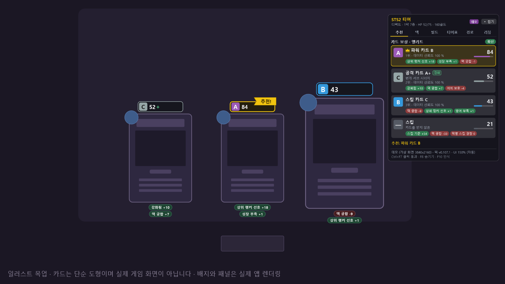
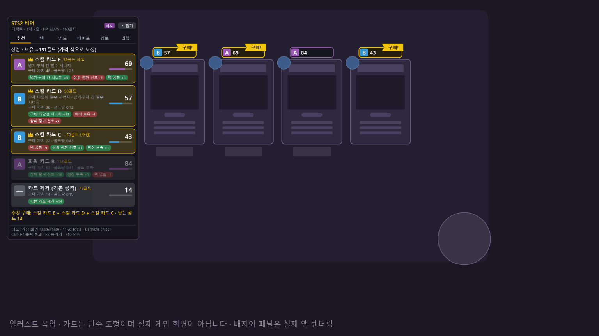
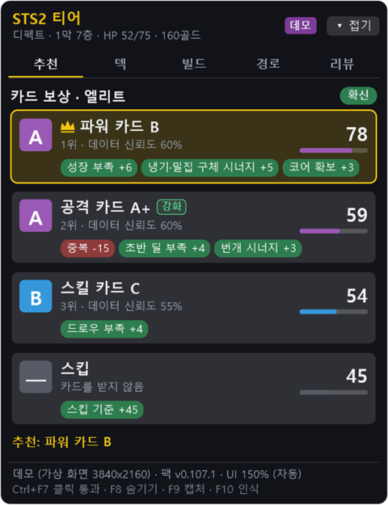
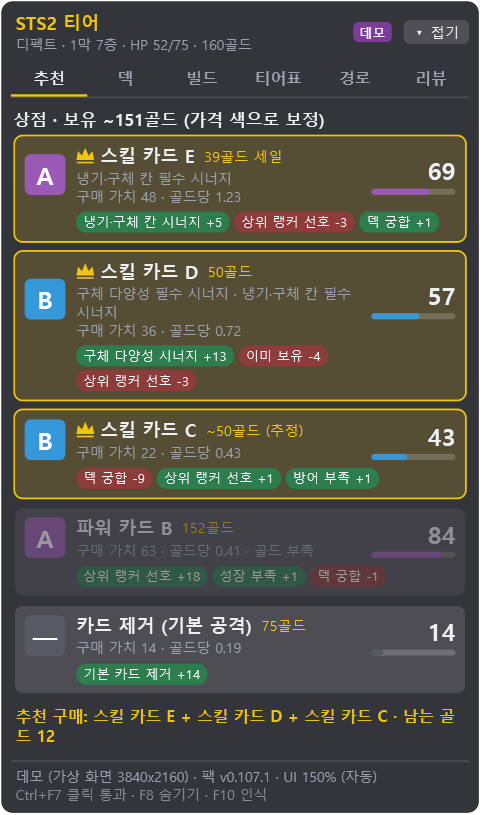
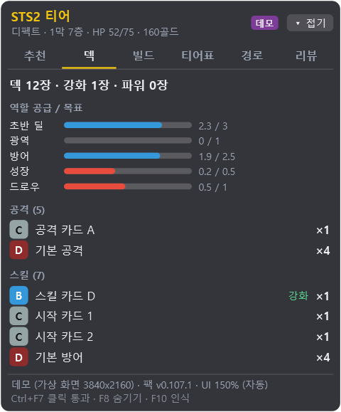
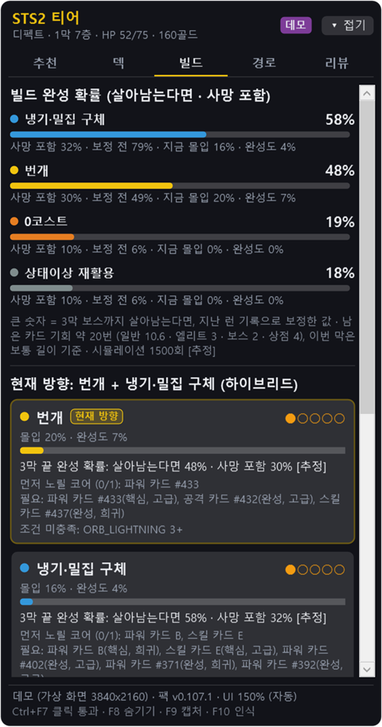
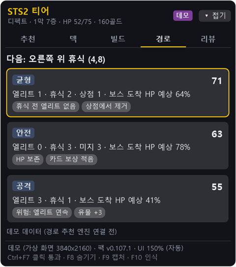
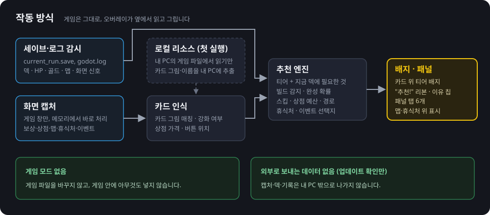
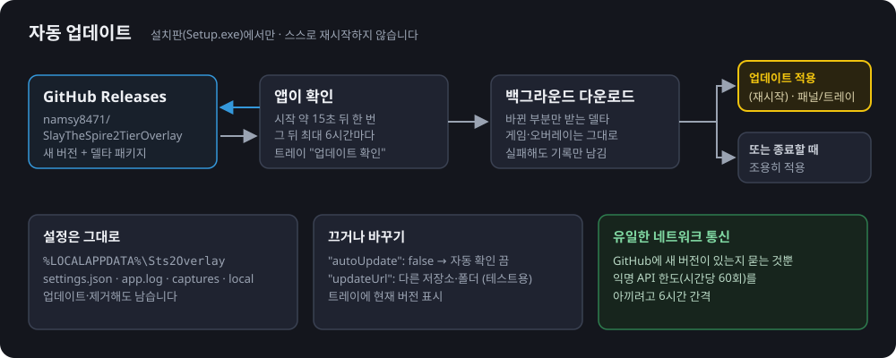

# Slay the Spire 2 Tier Overlay

[한국어](README.md) · **English**

A Windows overlay for Slay the Spire 2 that puts **card tier badges** on the game screen and recommends **the choice that fits your current deck** on rewards, shops, the map, rest sites and events.



<sub>The picture above is an illustrative mock-up. The cards are hand-drawn shapes; only the badges and the panel on the right are drawn by the app. Card names are placeholders such as "파워 카드 B" (Power card B). The screenshots in this README show the Korean UI; the app also runs in English.</sub>

> **Unofficial fan tool.** Not affiliated with, approved or endorsed by Mega Crit.

## At a glance

- **No game mod.** It never changes game files or injects anything into the game.
- It only **reads** the save and log files to know your deck, HP, gold and map, and **recognizes the game window** to see the cards offered on reward and shop screens.
- Cards are ranked by **a model trained on what top players actually picked**, combined with **what your deck is missing** (AoE, block, draw…), **the build you are heading for**, **your gold** and **the path ahead**.
- **It says so when it doesn't know.** Cards without tier data, event options with unknown effects, and HP/gold that a co-op guest cannot see are shown as "?" or "No data" instead of a made-up number.
- Korean and English UI. By default it follows the game's language setting; you can also pick one from the tray menu **"언어 / Language"**.
- Works in single player and in co-op (host and guest).

## Features

### Badges and the "Pick!" ribbon on the cards

When a reward or shop screen opens, every card gets a badge with its **tier letter (S·A·B·C·D) and score**. The best card gets a gold outline and a **"Pick!"** ribbon (**"Buy!"** in shops), and reason chips under each card explain the score (for example "Top players' preference +8"). When taking no card is better you get **"Skip!"**, and when removing a card in the shop is worth it a **"Remove a card"** marker appears over the removal button.

| Tier | S | A | B | C | D | ? |
|---|---|---|---|---|---|---|
| Badge colour | gold | purple | blue | grey | dark red | no rating data |

- **Cards without tier data** (for example cards added by a game patch) get a "?" badge and are never recommended. If every card on screen is like that, there is no pick and no skip verdict, only a note that the cards have no rating data.
- **When only some cards were read** (2 of 3, say), the badges are shown but the ribbon and skip verdict wait, with a "reading 2 of 3 cards…" note. If the last card still can't be read after 2 seconds, it decides anyway and says so.
- Badges disappear within about a second after the screen closes, and cards you already bought in a shop don't leave badges or "Buy!" behind on the empty slot.
- Temporary card choices during combat are not deck additions, so they are not rated like rewards.



<sub>Shop mock-up. It reads the price colours too (red = you can't afford it) and picks the best set of purchases within your budget. If a price tag is covered it estimates from rarity ("~50 gold (est.)"). Once you have used the card removal, it is dropped from the suggested set and the budget.</sub>

### Rewards, shops and events share one card value

Card rewards, shop cards and the "gain this card" option in events all use **the same calculation**. A card the reward screen told you to skip won't get "Buy!" in the very next shop.

- The model was trained on **solo Ascension 10 top-player runs**. In co-op the panel notes that the advice is based on solo A10 runs with no co-op adjustment.
- **Co-op-only cards** have no solo data, so they are tagged "Co-op only · no solo data" and are not given high confidence.
- To use only the hand-tuned rules instead of the learned model, set `"cardModel": "engine"` in `settings.json`.

### Relic advice (shop and Ancients)

- **Shop relics**: the three relics in the shop are read from the screen, compared on the same list as cards and card removal, and included in the suggested purchases within budget.
- **Ancient choices**: the relic options offered by Neow and the act 2 and 3 Ancients are compared, and the recommended option button gets "Pick!".
- Relic scores include **how well the relic fits the build your deck is heading for**, based on which relics top players actually took in that build.

### The panel: Picks, Deck, Build, Tiers, Path, Review

A small panel that sits to the right of the game. It starts on the monitor the game is on, can be dragged anywhere, and remembers its position and last tab. It switches to **Picks** once when a card or shop screen **newly opens** (a price colour change won't drag you away from another tab).

| Picks (card reward) | Picks (shop) |
|---|---|
|  |  |
| Ranking, score, reason chips, skip score | Purchase value, value per gold, suggested purchases and leftover gold |

| Deck | Build | Path |
|---|---|---|
|  |  |  |
| Whether early damage, AoE, block, scaling and draw meet their targets; tier per card | The build your deck is heading for, its odds of coming together by act 3, the core cards to go for first | Paths compared by elites, rests and shops and the HP you are expected to reach the boss with |

<sub>The screenshots are the demo-mode (`--demo`) panel rendered off-screen, in Korean. Card names are placeholders such as "공격 카드 A" (Attack card A) and card thumbnails are left out. In real use you see card names and small card images built on your own PC. The path tab shows fixed demo data. There is no screenshot of the Tiers tab yet.</sub>

- **Build tab**: hover a card image to see its cost, effect text and upgraded text, with the numbers that change on upgrade in green as in the game. Build conditions are shown in game terms rather than internal tags.
- **Tiers tab**: pick one of the five characters or colourless and see every card's tier as image tiles in S, A, B, C, D and unrated sections. It follows your character when a run starts.
  - Filter by type (attack, skill, power) and rarity, and search by name (Korean initial-consonant search works too).
  - Cards in your deck get a gold ✓ (✓2 for two or more), and a card whose tier in the current act differs from its base tier shows it, for example "Act 1: A".
  - Co-op-only cards are tagged and hidden in solo runs (a chip brings them back).
  - Hover a tile for a large image, the effect text and a one-line tip.
  - The tier is the card's base rating. The ranking on a reward screen also weighs your deck and top players' tendencies, so it can differ from the Tiers tab.
- **Path tab**: accounts for each act having only a few easy hallway fights before they get harder. A path made of nothing but hallway fights gets a "hard hallway fights N" chip, and each extra card reward in the same act is valued slightly less.
- **Review tab**: after a run, compares your card choices with the advice (how often you took the top pick, and the choices that differed most). It judges against **the advice that was actually on screen during play**, so updating the overlay doesn't change the review of a past run. Only decisions without a record are recalculated with the current version and marked as such.

### Advice drawn on the game screen (map, rest sites, events)

- **Map**: the recommended next node and path are drawn on the game's own map and follow it when you scroll.
- **Rest sites**: "Pick!" on the recommended Rest or Smith button, and "Upgrade!" on the card to upgrade in the Smith grid. When the two are close it shows "Pick! (close)".
- **Events**: "Pick!" on the recommended option button. It only recommends an option whose effect is known and that actually comes out ahead; options with unknown effects are marked "No data" or "Partly estimated", and events with no data at all say so. If it isn't sure the event page has changed, it hides the marker rather than show a wrong one.
- **Training dummy event**: simulates a 3-turn fight with your current deck many times to get the kill chance for each setting, and recommends by reward value × kill chance. Below 50% the option is marked "Hard to kill".
- Toggle the map and rest site markers with `Ctrl+F5` or the tray item "Show advice on Map / Rest Site".

### Co-op

- **Map votes**: in co-op, clicking a map node (voting) does not move your current position until the party actually moves; the node you voted for is marked **"My vote"**, and **"Both voted"** when your ally picked the same node. In solo a vote is the move, so the advice moves on right away.
- **Guests (not the host)**: a guest has no save file, so the run is rebuilt from the game log alone. HP and gold that can't be known are shown as unknown instead of starting values.
  - At rest sites there is no Rest vs Smith verdict, only the upgrade ranking.
  - Events warn that HP is unknown instead of judging death risk or gold.
  - Shops judge affordability from the price colour (red = can't afford) only.
  - The Path tab explains that a guest can't receive map data, and the Deck tab notes that the deck is estimated from the log.

### Staying out of the way of game tooltips

When you hover a card, relic or event option in the game to read its tooltip, the overlay briefly turns transparent to get out of the way, and comes back 0.3 seconds after you move off. Hovering the overlay's own panel doesn't hide the badges.

## How it works



- **Save and log watching**: reads the game's `current_run.save` and `godot.log` for the deck, HP, gold, map and signals such as "a reward screen just opened". It looks for the saves folder again every 10 seconds, so it follows you if the game was never started before or you switch profiles. If a game update changes the save or log format slightly, it skips only the lines it can't read, keeps running and shows a note on the panel.
- **Screen capture**: the save only changes after you pick a card, so the cards on reward and shop screens are read by capturing the game window. It captures only the game window and only while the game is in front (3 times a second on reward and shop screens, less often otherwise), processes the image in memory and throws it away. Nothing is written to disk. Capture pauses 3 seconds after you hide the overlay or switch to another window.
- **Card recognition**: on first run it **reads the game files installed on your PC** to build card images and names, kept only on your PC, and matches them against the captured cards.
- **Advice engine**: scores options with the model trained on top-player runs and the tier data, plus your current deck, build, gold and the path ahead.

## Install

**Requirements**: Windows 10 2004 or later (64-bit) and Slay the Spire 2 installed through Steam.

1. Download `namsy8471.Sts2Overlay-win-Setup.exe` from the [**latest release page**](https://github.com/namsy8471/SlayTheSpire2TierOverlay/releases/latest).
2. Run it. It installs right away and adds Start menu and desktop shortcuts. No administrator rights needed (it installs to `%LocalAppData%\namsy8471.Sts2Overlay` for your account).
3. If a blue **"Windows protected your PC"** window appears, click **More info → Run anyway**. The warning appears because this personal project has no code-signing certificate.
4. On first run it finds the game folder and builds card images and names in `%LOCALAPPDATA%\Sts2Overlay\local` (a few seconds). Progress shows on an orange line at the bottom of the panel. Steam installed outside the default location is found through the Steam path in the registry.

After that, just keep the game and the overlay running. The overlay is visible **only while the game is in front**.

## Automatic updates



- About **15 seconds** after start, the overlay checks GitHub Releases for a new version, then checks **at most every 6 hours**.
- A new version is downloaded **in the background** as a delta package (only what changed), so it is usually small.
- When it's ready, a tray notification and a green line on the panel tell you, along with **what's new** (the first items of the release notes). The tray menu gains **"Apply update (restart) vX"**, which applies it and restarts right away. Otherwise it is applied **quietly when you close the overlay**. It never restarts itself mid-game.
- What changed in each version is in the release notes on the [releases page](https://github.com/namsy8471/SlayTheSpire2TierOverlay/releases).
- The tray menu shows the current version and has **"Check for updates"**.
- To turn updates off, set `"autoUpdate": false` in `settings.json`.
- Settings and records (`%LOCALAPPDATA%\Sts2Overlay`) are kept across updates.

## Usage

### Hotkeys

Hotkeys work only while the game is in front (including the tray menu opened from the game). When another program is in front it receives the same keys as usual (for example `Ctrl+F5` to refresh a browser).

| Key | Action |
|---|---|
| `Ctrl+F5` | Toggle advice on the map and rest sites |
| `Ctrl+F6` | Toggle panel always on top |
| `Ctrl+F7` | Panel click-through (when you need to click what's under it) |
| `Ctrl+F8` | Hide/show the whole overlay |
| `Ctrl+F10` | Recognize now |
| `Ctrl+F11` | Show recognition areas (card and price boxes, for troubleshooting) |

If another program already uses one of these keys, a "hotkey registration failed" line stays at the bottom of the panel (with a one-time tray notification), and it tries again each time you return to the game. Everything a hotkey does is also in the tray menu.

### Tray icon

The gold **S** icon in the notification area. Double-click to hide/show. The right-click menu has:

- Hide/show overlay, Always on top, Click-through, Show advice on Map / Rest Site, Recognize now
- Show overlay in streams/captures
- **UI scale** (Auto: 100% at FHD, 150% at 4K)
- **언어 / Language** (Auto = follow the game, 한국어, English)
- **Advanced**: Show recognition areas, Demo mode, Reload data pack
- Version, Check for updates, Exit

### Settings and records

Everything lives in `%LOCALAPPDATA%\Sts2Overlay` and survives updates and uninstalling.

| File / folder | Contents |
|---|---|
| `settings.json` | Settings. Panel position and tab are saved automatically, so close the overlay before editing by hand |
| `settings.json.bad` | The original `settings.json` kept aside when it had a typo and couldn't be read. The overlay starts with defaults and won't overwrite the original until you change a setting |
| `app.log` | Log (rolls over to `app.log.1` past 5 MB). Steam IDs, user folder paths and e-mail addresses are masked as they are written, so you can attach it as is when reporting a problem |
| `local\` | Card images and names built from the game files on your PC (installed version) |
| `decisions\` | What the overlay recommended on card rewards, card choices and shops during play (one `.jsonl` file per run with card/relic IDs, scores, floor and app version only; last 300 runs). Used only by the Review tab to compare the advice at the time with your choice. It is not used for scoring, never leaves your PC, and is safe to delete (the review then recalculates with the current version) |

Common `settings.json` entries:

| Key | Default | Description |
|---|---|---|
| `gameDir` | `null` (auto) | Game install folder. Set it only if it can't be found automatically |
| `uiScale` | `null` (auto) | UI scale (`1.5` = 150%). Also in the tray menu |
| `panelOpacity` | `0.86` | Panel background opacity (0.3 to 1) |
| `alwaysOnTop` | `true` | Panel always on top (`Ctrl+F6`) |
| `mapOverlay` | `true` | Advice on the map and rest sites (`Ctrl+F5`) |
| `showOverlayInCapture` | `true` | Show the overlay in streams, recordings and screenshots (see FAQ) |
| `language` | `"auto"` | UI language: `"auto"` (follow the game), `"kor"`, `"eng"`. Also in the tray menu |
| `cardModel` | `"learned"` | Card value: `"learned"` (model trained on top players), `"engine"` (hand-tuned rules only) |
| `captureBackend` | `"auto"` | `"gdi"` is slower but more compatible |
| `autoUpdate` | `true` | Automatic updates |
| `updateUrl` | `null` | Where to get updates (for testing; empty means the official releases) |

## Privacy and copyright

- This is an **unofficial fan tool**, not affiliated with, approved or endorsed by Mega Crit. Slay the Spire 2 and its art and text belong to Mega Crit.
- **No game files are distributed.** Neither the installer nor this repository contains card art or game text such as card names and descriptions. The data pack holds only internal game IDs (such as `CARD.BALL_LIGHTNING`), our own tiers and notes, aggregate statistics from top-player runs and the learned model's weights.
- Card images and names are built **on the player's own PC from the game files they installed**, only in `%LOCALAPPDATA%\Sts2Overlay\local`. Game files are only read.
- **Nothing is sent out.** Captures, decks, run history, advice records and logs never leave your PC. The only network traffic is checking GitHub for a new version and downloading it.
- `app.log` is written with Steam IDs, paths containing your Windows user name and e-mail addresses masked.

## FAQ

**What happens when the game updates?**
On the next start the overlay notices the game files changed and rebuilds card images and names (a few seconds). Cards with no tier in the data pack are listed **by name** on an orange line at the bottom of the panel; they get a "?" badge and are never recommended, and everything else works as before. If the save or log format changed and some of it can't be read, only that part is skipped and the panel shows a note. A version with a new data pack arrives through automatic updates.

**A "Windows protected your PC" window appears.**
That is the SmartScreen warning for programs without a signing certificate. Click **More info → Run anyway**. If you'd rather not, you can build it yourself from this repository (see For developers).

**I can't see the overlay.**
- It shows **only while the game window is in front**. If you clicked another window, click the game again.
- Check that you didn't hide it with `Ctrl+F8` (if the first tray menu item is "Show overlay", it is hidden).
- Badges appear only on reward and shop screens. If they don't show up right away, press `Ctrl+F10` (recognize now).
- Run the game **windowed or borderless fullscreen**. In exclusive fullscreen other windows may not be drawn on top.
- Leave the game's **aspect ratio** option at its default **16:9**. With 16:9 it is accurate on 16:10 monitors, ultrawides and maximized windows (1920x1017 and so on). Other values (16:10, 4:3, 21:9, auto) can misplace cards and markers on some screens, and the panel shows a note when that happens.
- If it still doesn't work, check `%LOCALAPPDATA%\Sts2Overlay\app.log` or attach it to an issue.

**I'm a co-op guest and HP and gold show as "?".**
That's expected. A guest has no save file, so HP and gold can't be known. Rather than advise from wrong numbers, the overlay shows "?" and skips the verdicts that need them (Rest vs Smith, death risk in events, shop budget) or judges from price colours only.

**How do I show or hide the overlay in streams and recordings?**
By default the overlay appears in OBS, Discord screen sharing and screenshots. To leave it out, turn off **"Show overlay in streams/captures"** in the tray menu. Either way recognition is unaffected (it captures only the game window). While the compatible capture (`"captureBackend": "gdi"`) is in use, the overlay is hidden from captures automatically so recognition works.

**My settings went back to defaults.**
If `settings.json` has a typo, the overlay starts with defaults and shows a note on the panel. The original is kept as `settings.json.bad`; fix the typo and rename it back to `settings.json`.

**How do I uninstall?**
Remove "STS2 티어 오버레이" (the installed app keeps its Korean name) in Windows **Settings → Apps → Installed apps**. The `%LOCALAPPDATA%\Sts2Overlay` folder with your settings, records and generated card images stays; delete it yourself for a clean removal.

**It says it's already running.**
Only one copy can run at a time. Look for the gold S icon in the notification area.

## For developers

You need the .NET 10 SDK and Windows. Project layout, inspection tools and data pack validation commands are in [docs/DEVELOPMENT.md](docs/DEVELOPMENT.md); releases and the auto-update setup are in [docs/DISTRIBUTION.md](docs/DISTRIBUTION.md) (both in Korean).

```powershell
dotnet build SlayTheSpire2TierOverlay.sln
dotnet test SlayTheSpire2TierOverlay.sln
dotnet run --project src/Sts2Overlay.App -- --demo reward   # see the UI without the game (reward | shop | other)
```

- **`build-exe.cmd`** (double-click): pulls the latest code with `git pull --ff-only` and rebuilds `dist\Sts2Overlay.exe` (single file). For use on your own PC, without automatic updates. Options `-NoPull`, `-Restart`, `-NoRestart`, `-NoPause`.
- **`release.cmd <version>`** (`tools\release.ps1`): checks that the working tree is clean and pushed, then creates and pushes the tag `v<version>`. GitHub Actions runs the tests, packages and uploads the release. `-DryRun` only checks; `-Local` builds and uploads from this PC.
- Design: [docs/PLAN.md](docs/PLAN.md) · Technical spike: [docs/SPIKE.md](docs/SPIKE.md) · Data pack format: [docs/DATA_SCHEMA.md](docs/DATA_SCHEMA.md) · Current pack: [data/packs/v0.107.1](data/packs/v0.107.1/README.md) · Competing tools: [docs/research/DECK_COMPASS.md](docs/research/DECK_COMPASS.md)
