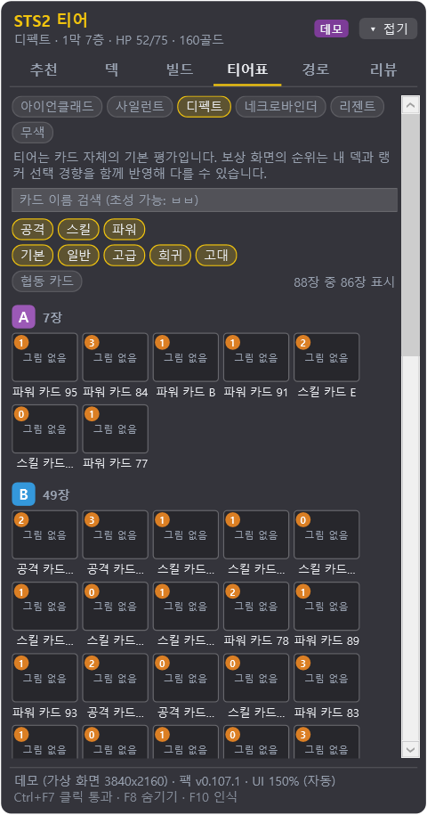

# Slay the Spire 2 티어 오버레이

**한국어** · [English](README.en.md)

슬레이 더 스파이어 2 화면 위에 **카드 티어 배지**를 띄우고, 보상·상점·맵·휴식처·이벤트에서 **지금 내 덱에 맞는 선택**을 추천하는 Windows용 오버레이입니다.


<sub>위 그림은 설명용 목업입니다. 카드는 직접 그린 도형이고, 배지와 오른쪽 패널만 실제 앱이 그린 것입니다. 카드 이름은 "파워 카드 B"처럼 가린 예시 이름입니다.</sub>

> **비공식 팬 도구입니다.** Mega Crit과 관련이 없고, Mega Crit의 승인이나 보증을 받지 않았습니다.

## 한눈에 보기

- **게임 모드를 쓰지 않습니다.** 게임 파일을 바꾸거나 게임 안에 무언가를 넣지 않습니다.
- 세이브·로그 파일을 **읽기만** 해서 덱·HP·골드·맵을 알고, 보상·상점에 뜬 카드는 **게임 창 화면을 인식**해서 알아냅니다.
- 카드 순위는 **상위 랭커들이 실제로 고른 기록으로 학습한 모델**이 정합니다. 여기에 **지금 덱에 부족한 것**(광역, 방어, 드로우…), **노리는 빌드**, **남은 골드**, **갈 길**이 함께 들어갑니다.
- **모르는 것은 모른다고 표시합니다.** 티어 데이터가 없는 카드, 효과를 모르는 이벤트 선택지, 협동 손님이라 알 수 없는 HP·골드에는 그럴듯한 숫자 대신 "?"나 "정보 없음"을 보여 줍니다.
- 한국어와 영어 UI. 기본으로 게임의 언어 설정을 따라가고, 트레이 **"언어 / Language"**에서 직접 고를 수도 있습니다.
- 1인 플레이와 협동(방장, 손님 모두)을 지원합니다.

## 기능

### 카드 위 배지와 "추천!" 리본

보상·상점 화면이 열리면 카드마다 **티어 글자(S·A·B·C·D)와 점수** 배지를 붙입니다. 가장 좋은 카드에는 금색 테두리와 **"추천!"**(상점은 **"구매!"**) 리본이 붙고, 카드 아래에는 점수의 이유가 칩으로 나옵니다(`성장 부족 +6`, `중복 -15`, `상위 랭커 선호 +8` 같은). 카드를 안 받는 게 나으면 **"스킵 추천!"**, 상점에서 카드 제거가 이득이면 제거 버튼 위에 **"제거 추천"**을 띄웁니다.

| 티어 | S | A | B | C | D | ? |
|---|---|---|---|---|---|---|
| 배지 색 | 금색 | 보라 | 파랑 | 회색 | 진한 빨강 | 평가 데이터 없음 |

- **티어 데이터가 없는 카드**(게임 패치로 새로 생긴 카드 등)는 "?" 배지를 달고 추천 대상에서 빠집니다. 화면의 카드가 모두 그렇다면 추천도 스킵 판정도 하지 않고 "평가 데이터가 없는 카드입니다"라고 알려 줍니다.
- **카드를 일부만 읽었을 때**(3장 중 2장 등)는 배지는 붙이되 "추천!"과 스킵 판정은 잠깐 보류하고 "3장 중 2장 인식 중…"을 표시합니다. 2초 뒤에도 못 읽으면 안내와 함께 판정합니다.
- 화면이 닫히면 배지는 1초 안팎으로 사라지고, 상점에서 이미 산 카드의 배지와 "구매!"는 빈 자리에 남지 않습니다.
- 전투 중에 뜨는 임시 카드 선택은 덱에 넣을 카드가 아니므로 보상 기준으로 평가하지 않습니다.


<sub>상점 목업. 가격 색(빨간 가격 = 살 수 없음)까지 읽어 예산 안에서 살 조합을 고릅니다. 가격표가 가려지면 희귀도로 추정합니다("~50골드 (추정)"). 카드 제거를 이미 썼다면 추천 조합과 예산에서 뺍니다.</sub>

### 보상·상점·이벤트가 같은 카드 가치를 씁니다

카드 보상, 상점의 카드, 이벤트의 "카드 획득" 선택지는 모두 **같은 계산**으로 카드 가치를 매깁니다. 그래서 보상에서 "스킵 추천!"이 나온 카드가 바로 다음 상점에서 "구매!"를 받는 식의 엇갈림이 없습니다.

- 학습 모델은 **솔로 승천 10 상위 랭커 기록**으로 만들었습니다. 협동에서는 "솔로 승천 10 랭커 기록 기준입니다 (협동 보정 없음)"이라는 안내가 함께 나옵니다.
- **협동 전용 카드**는 솔로 기록이 없으므로 "협동 전용 · 솔로 기록 없음" 표시가 붙고, 신뢰도를 높게 보지 않습니다.
- 학습 모델 대신 손으로 만든 규칙 엔진만 쓰고 싶다면 `settings.json`에 `"cardModel": "engine"`을 적으세요.

### 유물 추천 (상점 · 고대)

- **상점 유물**: 상점에 놓인 유물 3개를 화면에서 읽어 카드·카드 제거와 같은 목록에서 비교하고, 예산 안의 추천 구매 조합에도 넣습니다.
- **고대 선택지**: 니오우와 2·3막 고대가 내미는 유물 선택지를 비교하고, 추천하는 선택지 버튼에 "추천!"을 붙입니다.
- 유물 점수에는 **지금 덱이 향하는 빌드와 잘 맞는지**가 들어갑니다. 상위 플레이어들이 그 빌드에서 실제로 고른 유물 기록을 근거로 합니다.

### 패널: 추천 · 덱 · 빌드 · 티어표 · 경로 · 리뷰

게임 오른쪽에 붙는 작은 패널입니다. 처음에는 게임이 있는 모니터에 붙고, 끌어서 옮길 수 있으며 위치와 마지막 탭을 기억합니다. 카드·상점 화면이 **새로 열릴 때** 한 번 **추천** 탭으로 바뀝니다(다른 탭을 보는 중에 가격 색이 바뀌는 정도로는 끌려가지 않습니다).

| 추천 (카드 보상) | 추천 (상점) |
|---|---|
|  |  |
| 순위, 점수, 이유 칩, 스킵 점수 | 구매 가치, 골드당 가치, 추천 구매 조합과 남는 골드 |

| 덱 | 빌드 |
|---|---|
|  |  |
| 초반 딜·광역·방어·성장·드로우가 목표만큼 있는지, 카드별 티어 | 지금 덱이 향하는 빌드, 3막까지 완성될 확률, 먼저 노릴 핵심 카드 |

| 티어표 | 경로 |
|---|---|
|  |  |
| 캐릭터별 전체 카드 티어, 종류·희귀도 필터와 이름 검색 | 엘리트·휴식·상점 수와 보스 도착 HP 예상으로 경로 비교 |

<sub>스크린샷은 데모 모드(`--demo`)의 패널을 화면에 띄우지 않고 그대로 렌더링한 것입니다. 카드 이름은 "공격 카드 A"처럼 가린 예시 이름이고, 카드 그림은 넣지 않았습니다(티어표의 "No art" 칸). 실제로는 내 PC에서 만든 카드 이름과 작은 카드 그림이 나옵니다. 경로 탭은 데모용 고정 데이터입니다.</sub>

- **빌드 탭**: 카드 그림에 마우스를 올리면 비용, 효과 문장, 강화 후 문장이 나옵니다. 강화로 바뀌는 숫자는 게임처럼 초록색입니다. 빌드 조건은 내부 태그 대신 게임 용어로 보여 줍니다.
- **티어표 탭**: 캐릭터 다섯과 무색 중 하나를 골라 전체 카드 티어를 S·A·B·C·D·미평가 구역으로 나눠 카드 그림 타일로 보여 줍니다. 런이 시작되면 그 캐릭터로 맞춰집니다.
  - 종류(공격·스킬·파워)와 희귀도 칩으로 거르고, 이름으로 찾을 수 있습니다. 한글 초성 검색도 됩니다("ㅂㅂ").
  - 내 덱에 있는 카드는 금색 ✓(두 장 이상이면 ✓2), 지금 막의 티어가 기본 티어와 다르면 "1막 A"처럼 표시합니다.
  - 협동 전용 카드는 "협동" 표시가 붙고, 솔로 런에서는 숨겨 둡니다(칩으로 다시 볼 수 있음).
  - 타일에 마우스를 올리면 큰 그림, 효과 문장, 한 줄 팁이 나옵니다.
  - 티어는 카드 자체의 기본 평가입니다. 보상 화면의 순위는 내 덱과 랭커 선택 경향까지 반영하므로 티어표와 다를 수 있습니다.
- **경로 탭**: 막마다 앞의 몇 번만 쉬운 일반 전투가 나오고 그 뒤로는 어려워진다는 점을 반영합니다. 일반 전투만 줄줄이 이어지는 길에는 "어려운 일반 전투 N" 칩이 붙고, 같은 막에서 카드 보상을 여러 번 받을수록 보상 가치를 조금씩 낮춰 봅니다.
- **리뷰 탭**: 런이 끝나면 내 카드 선택을 추천과 비교합니다(추천 1순위와 같았던 비율, 가장 크게 달랐던 선택). 기준은 **플레이 중 실제로 화면에 떴던 추천**입니다. 그래서 오버레이를 업데이트해도 지난 런의 리뷰 결과가 바뀌지 않습니다. 기록이 없는 결정만 현재 버전으로 다시 계산하고 "재계산"이라고 표시합니다.

### 게임 화면 위 추천 (맵 · 휴식처 · 이벤트)

- **맵**: 추천하는 다음 칸과 길을 게임 지도 위에 직접 그립니다. 지도를 스크롤해도 따라갑니다.
- **휴식처**: 휴식과 재련 중 추천하는 버튼에 "추천!"을, 재련 화면에서는 강화할 카드에 "강화 추천!"을 붙입니다. 두 선택이 비슷하면 "추천! (박빙)"으로 표시합니다.
- **이벤트**: 추천하는 선택지 버튼에 "추천!"을 붙입니다. 효과를 아는 선택지가 실제로 앞설 때만 추천하고, 효과를 모르는 선택지에는 "정보 없음"이나 "일부 추정"을 붙입니다. 아직 데이터가 없는 이벤트에서는 "이 이벤트는 아직 데이터가 없습니다"라고 알려 줍니다. 이벤트 페이지가 넘어갔는지 확실하지 않으면 틀린 표시 대신 표시를 숨깁니다.
- **훈련 인형 이벤트**: 지금 덱으로 3턴 전투를 여러 번 시뮬레이션해서 설정마다 처치 확률을 구하고, 보상 가치 × 처치 확률로 추천합니다. 처치 확률이 50% 미만이면 "처치 어려움"이 붙습니다.
- 맵·휴식처 표시는 `Ctrl+F5` 또는 트레이 "맵·휴식처 위 추천 표시"로 끄고 켭니다.

### 협동 플레이

- **맵 투표**: 협동에서 맵 칸을 클릭(투표)해도 현재 위치는 일행이 실제로 움직일 때까지 그대로이고, 투표한 칸에 **"내 투표"**를 표시합니다. 동료와 같은 칸을 골랐으면 **"투표 일치"**가 나옵니다. 솔로에서는 투표가 곧 이동이라 바로 다음 위치 기준으로 추천합니다.
- **손님(방장이 아닌 쪽)**: 손님은 세이브 파일이 없어 게임 로그로만 런을 재구성합니다. 이때 알 수 없는 HP와 골드는 시작 수치를 지어내지 않고 `HP ? · 골드 ? · 로그 추정`으로 표시합니다.
  - 휴식처에서는 휴식/재련 판정을 하지 않고, 강화할 카드 추천만 보여 줍니다.
  - 이벤트에서는 죽음·골드 판정 대신 "HP 모름: 체력 손실 주의"를 띄웁니다.
  - 상점에서는 가격 글자 색(빨강 = 살 수 없음)만으로 구매 가능 여부를 판단합니다.
  - 경로 탭은 지도 정보를 받을 수 없다고 안내하고, 덱 탭에는 "로그로 추정한 덱"이라는 안내가 붙습니다.

### 게임 툴팁을 가리지 않기

게임에서 카드·유물·이벤트 선택지 등에 마우스를 올려 툴팁을 읽으려 하면, 오버레이가 잠깐 투명해져 비켜 줍니다. 마우스를 떼면 0.3초 뒤 다시 나타납니다. 오버레이 패널 위에 마우스를 올렸을 때는 배지가 숨지 않습니다.

## 작동 방식


- **세이브·로그 감시**: 게임이 쓰는 `current_run.save`와 `godot.log`를 읽어 덱, HP, 골드, 맵, "지금 보상 화면이 열렸다" 같은 신호를 얻습니다. 세이브 폴더는 10초마다 다시 찾으므로, 게임을 처음 켜거나 프로필을 바꿔도 따라갑니다. 게임 업데이트로 세이브·로그 형식이 조금 바뀌어도 읽지 못한 줄만 건너뛰고 계속 동작하며, 패널에 안내를 띄웁니다.
- **화면 캡처**: 세이브는 카드를 고른 뒤에야 바뀌므로, 보상·상점에 뜬 카드는 게임 창을 캡처해 알아냅니다. 게임 창만, 게임이 앞에 있을 때만 캡처하고(보상·상점일 때 초당 3번, 평소에는 더 드물게), 메모리에서 처리한 뒤 버립니다. 디스크에는 쓰지 않습니다. 오버레이를 숨기거나 다른 창으로 전환하면 3초 뒤 캡처를 멈춥니다.
- **카드 인식**: 처음 실행할 때 **내 PC에 설치된 게임 파일을 읽어** 카드 그림과 이름을 내 PC 안에만 만들어 두고, 캡처 속 카드 그림과 맞춰 봅니다.
- **추천 엔진**: 랭커 기록으로 학습한 모델과 티어 데이터에 지금 덱 상황, 빌드, 골드, 남은 길을 더해 점수를 매깁니다.

## 설치

**필요한 것**: Windows 10 2004 이상(64비트), Steam으로 설치한 Slay the Spire 2.

1. [**최신 릴리스 페이지**](https://github.com/namsy8471/SlayTheSpire2TierOverlay/releases/latest)에서 `namsy8471.Sts2Overlay-win-Setup.exe`를 받습니다.
2. 실행하면 바로 설치되고 시작 메뉴와 바탕 화면에 바로 가기가 생깁니다. 관리자 권한은 필요 없습니다(내 계정의 `%LocalAppData%\namsy8471.Sts2Overlay`에 설치).
3. **"Windows의 PC 보호"** 파란 창이 뜨면 **추가 정보 → 실행**을 누르세요. 코드 서명 인증서가 없는 개인 프로젝트라서 뜨는 경고입니다.
4. 첫 실행 때 게임 폴더를 찾아 카드 그림·이름을 `%LOCALAPPDATA%\Sts2Overlay\local`에 만듭니다(몇 초). 진행 상황은 패널 아래 주황색 줄에 나옵니다. Steam을 기본 위치가 아닌 곳에 깔았어도 레지스트리의 Steam 경로로 찾아냅니다.

그다음부터는 게임과 오버레이를 켜 두기만 하면 됩니다. 오버레이는 **게임이 앞에 있을 때만** 보입니다.

## 자동 업데이트


- 오버레이가 켜지고 **약 15초 뒤** GitHub Releases에 새 버전이 있는지 확인하고, 그 뒤로는 **최대 6시간마다** 확인합니다.
- 새 버전이 있으면 **백그라운드에서** 받습니다. 바뀐 부분만 받는 델타 패키지라서 보통 작습니다.
- 다 받으면 트레이 알림과 패널 아래 초록색 줄로 알려 주고, 이번 버전의 **"바뀐 점"**(릴리스 노트의 첫 항목들)을 함께 보여 줍니다. 트레이 메뉴에는 **"업데이트 적용 (재시작) vX"**가 생깁니다. 누르면 바로 바꾸고 다시 켭니다. 안 누르면 **오버레이를 끌 때 조용히** 적용됩니다. 게임 중에 스스로 재시작하는 일은 없습니다.
- 버전마다 무엇이 바뀌었는지는 [릴리스 페이지](https://github.com/namsy8471/SlayTheSpire2TierOverlay/releases)의 릴리스 노트에 적어 둡니다.
- 트레이 메뉴에 지금 버전이 나오고, **"업데이트 확인"**으로 바로 확인할 수도 있습니다.
- 끄려면 `settings.json`에 `"autoUpdate": false`를 적으세요.
- 설정과 기록(`%LOCALAPPDATA%\Sts2Overlay`)은 업데이트해도 그대로입니다.

## 사용법

### 단축키

게임이 앞에 있을 때(게임에서 연 트레이 메뉴 포함)만 동작합니다. 다른 프로그램이 앞에 있으면 그 프로그램이 같은 키를 그대로 받습니다(예: 브라우저의 `Ctrl+F5` 새로 고침).

| 키 | 기능 |
|---|---|
| `Ctrl+F5` | 맵·휴식처 위 추천 표시 켜기/끄기 |
| `Ctrl+F6` | 패널 항상 맨 앞에 표시 켜기/끄기 |
| `Ctrl+F7` | 패널 클릭 통과 (패널 아래를 클릭해야 할 때) |
| `Ctrl+F8` | 오버레이 모두 숨기기/보이기 |
| `Ctrl+F10` | 지금 바로 인식 |
| `Ctrl+F11` | 인식 영역 표시 (카드·가격 상자, 점검용) |

다른 프로그램이 같은 키를 쓰고 있으면 패널 아래에 "단축키 등록 실패" 줄이 남고(처음 한 번은 트레이 알림도 뜹니다), 게임으로 돌아올 때마다 다시 등록해 봅니다. 단축키로 하는 일은 모두 트레이 메뉴에도 있습니다.

### 트레이 아이콘

작업 표시줄 알림 영역의 금색 **S** 아이콘입니다. 더블클릭하면 숨기기/보이기. 오른쪽 클릭 메뉴에는 다음이 있습니다.

- 오버레이 숨기기/보이기, 항상 맨 앞, 클릭 통과, 맵·휴식처 위 추천 표시, 지금 인식
- 방송·캡처에 오버레이 표시
- **UI 배율** (자동: FHD 100%, 4K 150%)
- **언어 / Language** (자동 = 게임 설정 따름, 한국어, English)
- **고급**: 인식 영역 표시, 데모 모드, 데이터 팩 다시 읽기
- 버전, 업데이트 확인, 종료

### 설정과 기록 위치

모두 `%LOCALAPPDATA%\Sts2Overlay`에 있습니다. 업데이트나 제거를 해도 지워지지 않습니다.

| 파일·폴더 | 내용 |
|---|---|
| `settings.json` | 설정. 패널 위치·탭은 자동 저장되니, 손으로 고칠 때는 오버레이를 끈 뒤에 고치세요 |
| `settings.json.bad` | `settings.json`에 오타가 있어 읽지 못했을 때 보관해 둔 원본. 오버레이는 기본값으로 켜지고, 설정을 바꾸기 전까지는 원본을 덮어쓰지 않습니다 |
| `app.log` | 기록 (5 MB를 넘으면 `app.log.1`로 넘김). Steam ID, 사용자 폴더 경로, 이메일 주소는 쓰는 시점에 가려지니, 문제를 알릴 때 그대로 첨부해도 됩니다 |
| `local\` | 내 PC의 게임 파일에서 만든 카드 그림·이름 (설치판) |
| `decisions\` | 플레이 중 오버레이가 카드 보상·카드 선택·상점에서 무엇을 추천했는지 (런마다 `.jsonl` 한 파일, 카드·유물 ID와 점수·층·앱 버전만, 최근 300판). 리뷰 탭이 "당시 추천"과 내 선택을 비교할 때만 씁니다. 추천 계산에는 쓰지 않고, 밖으로 보내지 않으며, 폴더를 지워도 안전합니다 (그러면 리뷰가 현재 버전으로 다시 계산) |

`settings.json`에서 자주 쓰는 항목:

| 항목 | 기본값 | 설명 |
|---|---|---|
| `gameDir` | `null` (자동) | 게임 설치 폴더. 자동으로 못 찾을 때만 적으세요 |
| `uiScale` | `null` (자동) | UI 배율 (`1.5` = 150%). 트레이에서도 바꿀 수 있습니다 |
| `panelOpacity` | `0.86` | 패널 배경 불투명도 (0.3~1) |
| `alwaysOnTop` | `true` | 패널 항상 맨 앞 (`Ctrl+F6`) |
| `mapOverlay` | `true` | 맵·휴식처 위 추천 (`Ctrl+F5`) |
| `showOverlayInCapture` | `true` | 방송·녹화·스크린샷에 오버레이 표시 (아래 FAQ) |
| `language` | `"auto"` | UI 언어. `"auto"`(게임 설정 따름), `"kor"`, `"eng"`. 트레이에서도 바꿀 수 있습니다 |
| `cardModel` | `"learned"` | 카드 가치 계산. `"learned"`(랭커 학습 모델), `"engine"`(손으로 만든 규칙만) |
| `captureBackend` | `"auto"` | `"gdi"`로 바꾸면 느린 대신 호환성이 좋은 캡처 |
| `autoUpdate` | `true` | 자동 업데이트 |
| `updateUrl` | `null` | 업데이트를 받을 곳 (테스트용. 비우면 공식 릴리스) |

## 개인정보와 저작권

- **비공식 팬 도구**입니다. Mega Crit과 관련이 없으며 승인이나 보증을 받지 않았습니다. Slay the Spire 2와 그 그림·텍스트의 권리는 Mega Crit에 있습니다.
- **게임 파일을 배포하지 않습니다.** 설치 파일과 이 저장소에는 카드 그림도, 카드 이름·설명 같은 게임 텍스트도 없습니다. 데이터 팩은 게임 내부 ID(`CARD.BALL_LIGHTNING` 같은)와 우리가 매긴 티어·주석, 상위 플레이어 기록을 모은 집계 통계와 학습 모델 가중치만 담습니다.
- 카드 그림과 이름은 **플레이어 본인의 PC에서, 본인이 설치한 게임 파일을 읽어** `%LOCALAPPDATA%\Sts2Overlay\local`에만 만듭니다. 게임 파일은 읽기만 합니다.
- **외부로 보내는 데이터가 없습니다.** 캡처, 덱, 런 기록, 추천 기록, 로그는 PC 밖으로 나가지 않습니다. 유일한 네트워크 통신은 GitHub에 새 버전이 있는지 묻고 받는 업데이트입니다.
- `app.log`에는 Steam ID, Windows 사용자 이름이 든 경로, 이메일 주소가 가려진 채로 기록됩니다.

## 자주 묻는 질문

**게임이 업데이트되면요?**
오버레이는 다음 실행 때 게임 파일이 바뀐 것을 알아채고 카드 그림·이름을 다시 만듭니다(몇 초). 데이터 팩에 티어가 없는 카드가 있으면 패널 아래 주황색 줄에 **그 카드 이름 목록**이 나옵니다. 이 카드들은 "?" 배지를 달고 추천 대상에서 빠지며, 나머지는 그대로 동작합니다. 세이브·로그 형식이 바뀌어 일부를 읽지 못하면 그 부분만 건너뛰고 패널에 안내를 띄웁니다. 새 데이터 팩이 담긴 버전이 나오면 자동 업데이트로 받아집니다.

**"Windows의 PC 보호" 창이 떠요.**
서명 인증서가 없는 프로그램이면 뜨는 SmartScreen 경고입니다. **추가 정보 → 실행**을 누르면 됩니다. 꺼림칙하면 이 저장소의 코드로 직접 빌드할 수도 있습니다(아래 개발자 안내).

**오버레이가 안 보여요.**
- 게임 창이 **앞에 있을 때만** 보입니다. 다른 창을 클릭했다면 게임을 다시 클릭하세요.
- `Ctrl+F8`로 숨겨 둔 건 아닌지 확인하세요(트레이 메뉴 첫 줄이 "오버레이 보이기"면 숨긴 상태).
- 배지는 보상·상점 화면에서만 나옵니다. 바로 안 뜨면 `Ctrl+F10`(지금 인식)을 눌러 보세요.
- 게임을 **창 모드나 테두리 없는 전체 화면**으로 쓰세요. 독점 전체 화면에서는 다른 창이 위에 그려지지 않을 수 있습니다.
- 게임 설정의 **화면 비율** 옵션은 기본값 **16:9**로 두세요. 이 옵션이 16:9이면 16:10 모니터, 울트라와이드, 최대화한 창(1920x1017 등)에서도 정확합니다. 다른 값(16:10, 4:3, 21:9, 자동)으로 바꾸면 일부 화면의 카드·표시가 어긋날 수 있고, 그때는 패널 아래에 안내 줄이 나옵니다.
- 그래도 안 되면 `%LOCALAPPDATA%\Sts2Overlay\app.log`를 확인하거나, 이슈에 첨부해 주세요.

**협동 손님인데 HP와 골드가 "?"로 나와요.**
정상입니다. 손님은 세이브 파일이 없어 HP와 골드를 알 수 없습니다. 틀린 숫자로 추천하지 않으려고 "?"로 표시하고, 그 값이 필요한 판정(휴식/재련, 이벤트의 죽음 위험, 상점 예산)은 하지 않거나 가격 색으로만 판단합니다.

**방송·녹화 화면에 오버레이가 나오게/안 나오게 하려면요?**
기본값으로 오버레이는 OBS, 디스코드 화면 공유, 스크린샷에 함께 나옵니다. 빼고 싶으면 트레이 **"방송·캡처에 오버레이 표시"**를 끄세요. 어느 쪽이든 인식에는 영향이 없습니다(인식은 게임 창만 캡처합니다). 호환 캡처(`"captureBackend": "gdi"`)를 쓰는 중에는 인식을 위해 오버레이를 캡처에서 자동으로 숨깁니다.

**설정이 기본값으로 돌아갔어요.**
`settings.json`에 오타가 있으면 기본값으로 켜지고 패널에 안내가 나옵니다. 원본은 `settings.json.bad`로 남아 있으니 오타를 고친 뒤 `settings.json`으로 이름을 바꾸세요.

**지우려면요?**
Windows **설정 → 앱 → 설치된 앱**에서 "STS2 티어 오버레이"를 제거하세요. 설정·기록·만들어 둔 카드 그림이 있는 `%LOCALAPPDATA%\Sts2Overlay` 폴더는 남으니, 깨끗이 지우려면 이 폴더도 직접 지우세요.

**"이미 실행 중입니다"라고 나와요.**
한 번에 하나만 켤 수 있습니다. 알림 영역의 금색 S 아이콘을 확인하세요.

## 개발자 안내

.NET 10 SDK와 Windows가 필요합니다. 프로젝트 구성, 점검 도구, 데이터 팩 검증 명령은 [docs/DEVELOPMENT.md](docs/DEVELOPMENT.md)에, 릴리스와 자동 업데이트 구조는 [docs/DISTRIBUTION.md](docs/DISTRIBUTION.md)에 있습니다.

```powershell
dotnet build SlayTheSpire2TierOverlay.sln
dotnet test SlayTheSpire2TierOverlay.sln
dotnet run --project src/Sts2Overlay.App -- --demo reward   # 게임 없이 UI 보기 (reward | shop | other)
```

- **`build-exe.cmd`** (더블클릭): `git pull --ff-only`로 최신 코드를 받아 `dist\Sts2Overlay.exe`(단일 파일)를 다시 만듭니다. 내 PC에서 쓰는 용도이고 자동 업데이트는 없습니다. 옵션 `-NoPull`, `-Restart`, `-NoRestart`, `-NoPause`.
- **`release.cmd <버전>`** (`tools\release.ps1`): 작업 트리가 깨끗하고 push됐는지 확인한 뒤 태그 `v<버전>`을 만들어 push합니다. 테스트, 패키지, 릴리스 업로드는 GitHub Actions가 합니다. `-DryRun`은 검사만, `-Local`은 이 PC에서 빌드·업로드.
- 설계: [docs/PLAN.md](docs/PLAN.md) · 기술 검증: [docs/SPIKE.md](docs/SPIKE.md) · 데이터 팩 형식: [docs/DATA_SCHEMA.md](docs/DATA_SCHEMA.md) · 현재 팩: [data/packs/v0.107.1](data/packs/v0.107.1/README.md) · 경쟁 도구 분석: [docs/research/DECK_COMPASS.md](docs/research/DECK_COMPASS.md)
