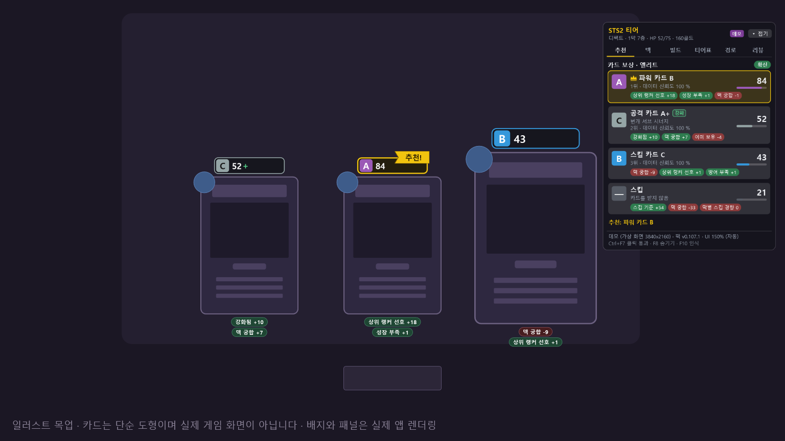
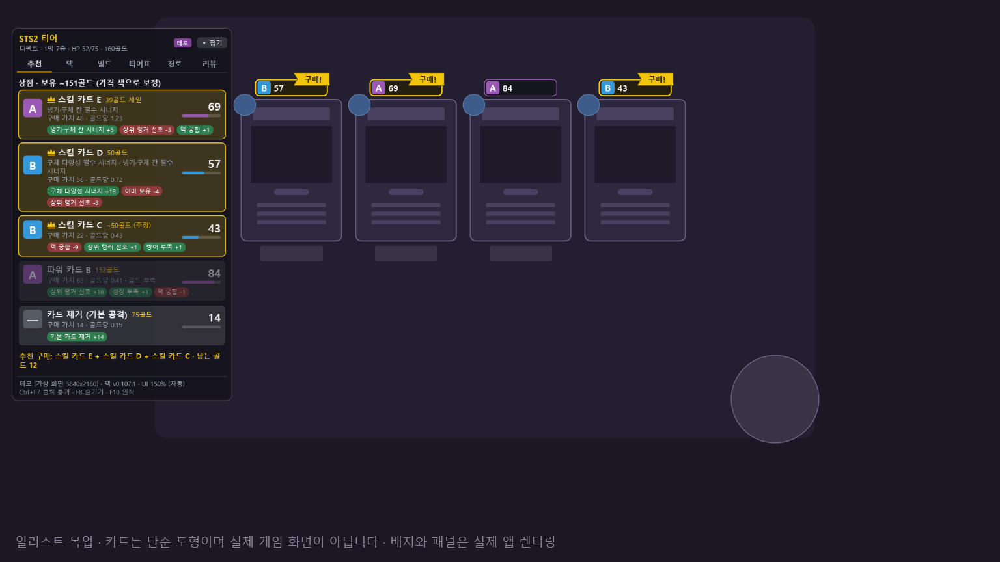
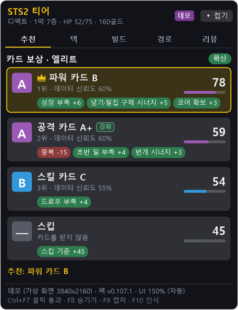
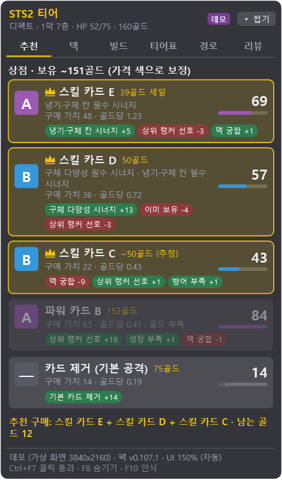
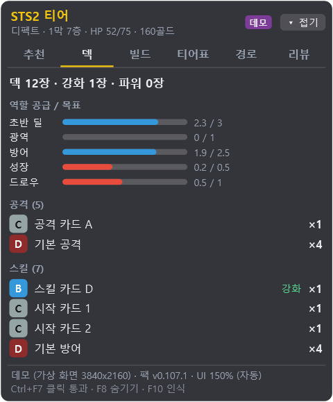
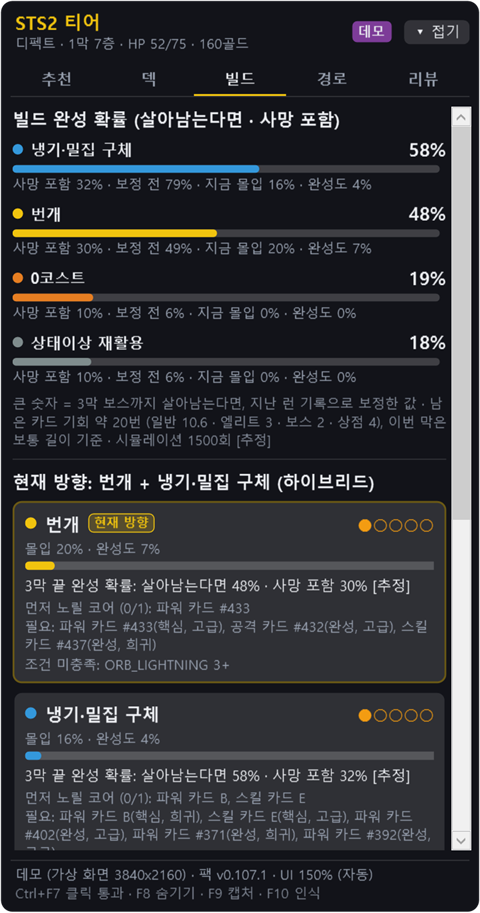
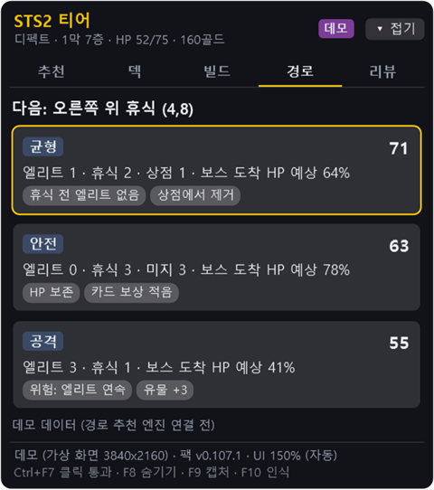
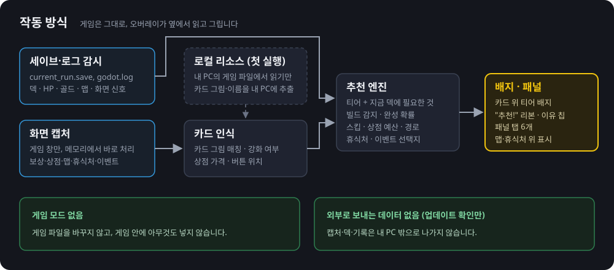
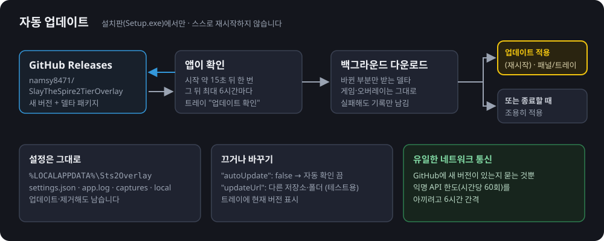

# Slay the Spire 2 티어 오버레이

슬레이 더 스파이어 2 화면 위에 **카드 티어 배지**를 띄우고, 보상·상점·맵·휴식처에서 **지금 내 덱에 맞는 선택**을 추천하는 Windows용 오버레이입니다.



<sub>위 그림은 설명용 목업입니다. 카드는 직접 그린 도형이고, 배지와 오른쪽 패널만 실제 앱이 그린 것입니다. 카드 이름은 "파워 카드 B"처럼 가린 예시 이름입니다.</sub>

> **비공식 팬 도구입니다.** Mega Crit과 관련이 없고, Mega Crit의 승인이나 보증을 받지 않았습니다.

## 이런 프로그램입니다

- **게임 모드를 쓰지 않습니다.** 게임 파일을 바꾸거나 게임 안에 무언가를 넣지 않습니다.
- 세이브·로그 파일을 **읽기만** 해서 덱·HP·골드·맵을 알고, 보상·상점에 뜬 카드는 **게임 창 화면을 인식**해서 알아냅니다.
- 티어만 보여 주는 게 아니라, **지금 덱에 부족한 것**(광역, 방어, 드로우…), **노리는 빌드**, **남은 골드**, **갈 길**까지 따져서 점수를 매깁니다.
- 한국어와 영어 UI. 기본으로 게임의 언어 설정을 따라가고, 트레이 **"언어 / Language"**에서 직접 고를 수도 있습니다.
- 1인 플레이와 협동(손님 포함) 모두 지원합니다.

## 기능

### 카드 위 배지와 "추천!" 리본

보상·상점 화면이 열리면 카드마다 **티어 글자(S·A·B·C·D)와 점수** 배지를 붙입니다. 가장 좋은 카드에는 금색 테두리와 **"추천!"**(상점은 **"구매!"**) 리본이 붙고, 카드 아래에는 점수의 이유가 칩으로 나옵니다(`성장 부족 +6`, `중복 -15` 같은). 카드를 안 받는 게 나으면 **"스킵 추천!"**, 상점에서 카드 제거가 이득이면 제거 버튼 위에 **"제거 추천: …"**을 띄웁니다.

| 티어 | S | A | B | C | D |
|---|---|---|---|---|---|
| 배지 색 | 금색 | 보라 | 파랑 | 회색 | 진한 빨강 |



<sub>상점 목업. 가격 색(빨간 가격 = 살 수 없음)까지 읽어 예산 안에서 살 조합을 고릅니다. 가격표가 가려지면 희귀도로 추정합니다("~50골드 (추정)").</sub>

### 유물 추천 (상점 · 고대)

- **상점 유물**: 상점에 놓인 유물 3개를 화면에서 읽어 카드·카드 제거와 같은 목록에서 비교하고, 예산 안의 추천 구매 조합에도 넣습니다.
- **고대 선택지**: 니오우와 2·3막 고대가 내미는 유물 선택지를 비교하고, 추천하는 선택지 버튼에 "추천!"을 붙입니다.
- 유물 점수에는 **지금 덱이 향하는 빌드와 잘 맞는지**가 들어갑니다. 상위 플레이어들이 그 빌드에서 실제로 고른 유물 기록을 근거로 합니다.

### 패널: 추천 · 덱 · 빌드 · 경로

게임 오른쪽에 붙는 작은 패널입니다. 끌어서 옮길 수 있고, 위치와 마지막 탭을 기억합니다. 보상·상점이 열리면 자동으로 **추천** 탭으로 바뀝니다.

| 추천 (카드 보상) | 추천 (상점) |
|---|---|
|  |  |
| 순위, 점수, 이유 칩, 스킵 점수 | 구매 가치, 골드당 가치, 추천 구매 조합과 남는 골드 |

| 덱 | 빌드 | 경로 |
|---|---|---|
|  |  |  |
| 초반 딜·광역·방어·성장·드로우가 목표만큼 있는지, 카드별 티어 | 지금 덱이 향하는 빌드, 3막까지 완성될 확률, 먼저 노릴 핵심 카드 | 엘리트·휴식·상점 수와 보스 도착 HP 예상으로 경로 비교 |

<sub>스크린샷은 데모 모드(`--demo`)의 패널을 화면에 띄우지 않고 그대로 렌더링한 것입니다. 카드 이름은 "공격 카드 A"처럼 가린 예시 이름이고 카드 그림 썸네일은 뺐습니다. 실제로는 내 PC에서 만든 한국어 카드 이름과 작은 카드 그림이 나옵니다. 경로 탭은 데모용 고정 데이터입니다.</sub>

- **빌드 탭 카드 툴팁**: 카드 그림에 마우스를 올리면 비용, 효과 문장, 강화 후 문장이 나옵니다. 강화로 바뀌는 숫자는 게임처럼 초록색입니다.
- **경로 탭**: 막마다 앞의 몇 번만 쉬운 일반 전투가 나오고 그 뒤로는 어려워진다는 점을 반영합니다. 일반 전투만 줄줄이 이어지는 길에는 "어려운 일반 전투 N" 칩이 붙고, 같은 막에서 카드 보상을 여러 번 받을수록 보상 가치를 조금씩 낮춰 봅니다.

### 게임 화면 위 추천 (맵 · 휴식처 · 이벤트)

- **맵**: 추천하는 다음 칸과 길을 게임 지도 위에 직접 그립니다. 지도를 스크롤해도 따라갑니다.
- **휴식처**: 휴식과 강화 중 추천하는 버튼, 강화할 카드에 "추천!"을 붙입니다.
- **이벤트**: 추천하는 선택지 버튼에 "추천!"을 붙입니다. 이벤트 페이지가 넘어갔는지 확실하지 않으면 틀린 표시 대신 표시를 숨깁니다.
- **훈련 인형 이벤트**: 지금 덱으로 3턴 전투를 여러 번 시뮬레이션해서 설정마다 처치 확률을 구하고, 보상 가치 × 처치 확률로 추천합니다. 처치 확률이 50% 미만이면 "처치 어려움"이 붙습니다.
- 맵·휴식처 표시는 `Ctrl+F5` 또는 트레이 "맵·휴식처 위 추천 표시"로 끄고 켭니다.

### 게임 툴팁을 가리지 않기

게임에서 카드·유물·이벤트 선택지 등에 마우스를 올려 툴팁을 읽으려 하면, 오버레이가 잠깐 투명해져 비켜 줍니다. 마우스를 떼면 0.3초 뒤 다시 나타납니다.

### 리뷰

런이 끝나면 **리뷰** 탭에서 내 카드 선택을 추천과 비교해 줍니다(추천 1순위와 같았던 비율, 가장 크게 달랐던 선택).

## 작동 방식



- **세이브·로그 감시**: 게임이 쓰는 `current_run.save`와 `godot.log`를 읽어 덱, HP, 골드, 맵, "지금 보상 화면이 열렸다" 같은 신호를 얻습니다.
- **화면 캡처**: 세이브는 카드를 고른 뒤에야 바뀌므로, 보상·상점에 뜬 카드는 게임 창을 캡처해 알아냅니다. 게임 창만, 게임이 앞에 있을 때만 캡처하고(보상·상점일 때 초당 3번, 평소에는 더 드물게), 메모리에서 처리한 뒤 버립니다. 디스크에는 쓰지 않습니다.
- **카드 인식**: 처음 실행할 때 **내 PC에 설치된 게임 파일을 읽어** 카드 그림과 이름을 내 PC 안에만 만들어 두고, 캡처 속 카드 그림과 맞춰 봅니다.
- **추천 엔진**: 티어 데이터에 지금 덱 상황, 빌드, 골드, 남은 길을 더해 점수를 매깁니다.

## 설치

**필요한 것**: Windows 10 2004 이상(64비트), Steam으로 설치한 Slay the Spire 2.

1. [**최신 릴리스 페이지**](https://github.com/namsy8471/SlayTheSpire2TierOverlay/releases/latest)에서 `namsy8471.Sts2Overlay-win-Setup.exe`를 받습니다.
2. 실행하면 바로 설치되고 시작 메뉴와 바탕 화면에 바로 가기가 생깁니다. 관리자 권한은 필요 없습니다(내 계정의 `%LocalAppData%\namsy8471.Sts2Overlay`에 설치).
3. **"Windows의 PC 보호"** 파란 창이 뜨면 **추가 정보 → 실행**을 누르세요. 코드 서명 인증서가 없는 개인 프로젝트라서 뜨는 경고입니다.
4. 첫 실행 때 게임 폴더를 찾아 카드 그림·이름을 `%LOCALAPPDATA%\Sts2Overlay\local`에 만듭니다(몇 초). 진행 상황은 패널 아래 주황색 줄에 나옵니다.

그다음부터는 게임과 오버레이를 켜 두기만 하면 됩니다. 오버레이는 **게임이 앞에 있을 때만** 보입니다.

## 자동 업데이트



- 오버레이가 켜지고 **약 15초 뒤** GitHub Releases에 새 버전이 있는지 확인하고, 그 뒤로는 **최대 6시간마다** 확인합니다.
- 새 버전이 있으면 **백그라운드에서** 받습니다. 바뀐 부분만 받는 델타 패키지라서 보통 작습니다.
- 다 받으면 트레이 알림과 패널 아래 초록색 줄로 알려 주고, 이번 버전의 **"바뀐 점"**(릴리스 노트의 첫 항목들)을 함께 보여 줍니다. 트레이 메뉴에는 **"업데이트 적용 (재시작) vX"**가 생깁니다. 누르면 바로 바꾸고 다시 켭니다. 안 누르면 **오버레이를 끌 때 조용히** 적용됩니다. 게임 중에 스스로 재시작하는 일은 없습니다.
- 버전마다 무엇이 바뀌었는지는 [릴리스 페이지](https://github.com/namsy8471/SlayTheSpire2TierOverlay/releases)의 릴리스 노트에 적어 둡니다.
- 트레이 메뉴에 지금 버전이 나오고, **"업데이트 확인"**으로 바로 확인할 수도 있습니다.
- 끄려면 `settings.json`에 `"autoUpdate": false`를 적으세요.
- 설정과 기록(`%LOCALAPPDATA%\Sts2Overlay`)은 업데이트해도 그대로입니다.

## 사용법

### 단축키

게임이 앞에 있을 때(게임에서 연 트레이 메뉴 포함)만 동작합니다. 다른 프로그램이 앞에 있으면 그 프로그램이 같은 키를 그대로 받습니다(예: 브라우저의 `Ctrl+F5` 새로 고침).

| 키 | 기능 |
|---|---|
| `Ctrl+F5` | 맵·휴식처 위 추천 표시 켜기/끄기 |
| `Ctrl+F6` | 패널 항상 맨 앞에 표시 켜기/끄기 |
| `Ctrl+F7` | 패널 클릭 통과 (패널 아래를 클릭해야 할 때) |
| `Ctrl+F8` | 오버레이 모두 숨기기/보이기 |
| `Ctrl+F10` | 지금 바로 인식 |
| `Ctrl+F11` | 인식 영역 표시 (카드·가격 상자, 점검용) |

다른 프로그램이 같은 키를 쓰고 있으면 패널 아래에 "단축키 등록 실패" 줄이 남고(처음 한 번은 트레이 알림도 뜹니다), 게임으로 돌아올 때마다 다시 등록해 봅니다. 단축키로 하는 일은 모두 트레이 메뉴에도 있습니다.

### 트레이 아이콘

작업 표시줄 알림 영역의 금색 **S** 아이콘입니다. 더블클릭하면 숨기기/보이기. 오른쪽 클릭 메뉴에는 숨기기, 항상 맨 앞, 클릭 통과, 맵·휴식처 위 추천, 방송·캡처에 오버레이 표시, **UI 배율**(자동: FHD 100%, 4K 150%), **언어 / Language**(자동 = 게임 설정 따름, 한국어, English), 지금 인식, **고급**(인식 영역 표시, 데모 모드, 데이터 팩 다시 읽기), 버전·업데이트 확인, 종료가 있습니다.

### 설정과 기록 위치

모두 `%LOCALAPPDATA%\Sts2Overlay`에 있습니다. 업데이트나 제거를 해도 지워지지 않습니다.

| 파일·폴더 | 내용 |
|---|---|
| `settings.json` | 설정. 패널 위치·탭은 자동 저장되니, 손으로 고칠 때는 오버레이를 끈 뒤에 고치세요 |
| `app.log` | 기록 (5 MB를 넘으면 `app.log.1`로 넘김). 문제를 알릴 때 첨부해 주세요 |
| `local\` | 내 PC의 게임 파일에서 만든 카드 그림·이름 (설치판) |

`settings.json`에서 자주 쓰는 항목:

| 항목 | 기본값 | 설명 |
|---|---|---|
| `gameDir` | `null` (자동) | 게임 설치 폴더. Steam 라이브러리에서 못 찾을 때만 적으세요 |
| `uiScale` | `null` (자동) | UI 배율 (`1.5` = 150%). 트레이에서도 바꿀 수 있습니다 |
| `panelOpacity` | `0.86` | 패널 배경 불투명도 (0.3~1) |
| `alwaysOnTop` | `true` | 패널 항상 맨 앞 (`Ctrl+F6`) |
| `mapOverlay` | `true` | 맵·휴식처 위 추천 (`Ctrl+F5`) |
| `showOverlayInCapture` | `true` | 방송·녹화·스크린샷에 오버레이 표시 (아래 FAQ) |
| `language` | `"auto"` | UI 언어. `"auto"`(게임 설정 따름), `"kor"`, `"eng"`. 트레이에서도 바꿀 수 있습니다 |
| `captureBackend` | `"auto"` | `"gdi"`로 바꾸면 느린 대신 호환성이 좋은 캡처 |
| `autoUpdate` | `true` | 자동 업데이트 |
| `updateUrl` | `null` | 업데이트를 받을 곳 (테스트용. 비우면 공식 릴리스) |

## 개인정보와 저작권

- **비공식 팬 도구**입니다. Mega Crit과 관련이 없으며 승인이나 보증을 받지 않았습니다. Slay the Spire 2와 그 그림·텍스트의 권리는 Mega Crit에 있습니다.
- **게임 파일을 배포하지 않습니다.** 설치 파일과 이 저장소에는 카드 그림도, 카드 이름·설명 같은 게임 텍스트도 없습니다. 데이터 팩은 게임 내부 ID(`CARD.BALL_LIGHTNING` 같은)와 우리가 매긴 티어·주석만 담습니다.
- 카드 그림과 이름은 **플레이어 본인의 PC에서, 본인이 설치한 게임 파일을 읽어** `%LOCALAPPDATA%\Sts2Overlay\local`에만 만듭니다. 게임 파일은 읽기만 합니다.
- **외부로 보내는 데이터가 없습니다.** 캡처, 덱, 런 기록, 로그는 PC 밖으로 나가지 않습니다. 유일한 네트워크 통신은 GitHub에 새 버전이 있는지 묻고 받는 업데이트입니다.

## 자주 묻는 질문

**게임이 업데이트되면요?**
오버레이는 다음 실행 때 게임 파일이 바뀐 것을 알아채고 카드 그림·이름을 다시 만듭니다(몇 초). 게임 버전이 데이터 팩보다 새로우면 패널 아래 주황색 줄에 "게임 버전 …이 데이터 팩 …보다 새롭습니다"와 **티어가 없는 새 카드 목록**이 나옵니다. 이 카드들은 기본 티어로 계산되고, 나머지는 그대로 동작합니다. 새 데이터 팩이 담긴 버전이 나오면 자동 업데이트로 받아지니, 그때까지 새 카드 점수는 참고만 하세요.

**"Windows의 PC 보호" 창이 떠요.**
서명 인증서가 없는 프로그램이면 뜨는 SmartScreen 경고입니다. **추가 정보 → 실행**을 누르면 됩니다. 꺼림칙하면 이 저장소의 코드로 직접 빌드할 수도 있습니다(아래 개발자 안내).

**오버레이가 안 보여요.**
- 게임 창이 **앞에 있을 때만** 보입니다. 다른 창을 클릭했다면 게임을 다시 클릭하세요.
- `Ctrl+F8`로 숨겨 둔 건 아닌지 확인하세요(트레이 메뉴 첫 줄이 "오버레이 보이기"면 숨긴 상태).
- 배지는 보상·상점 화면에서만 나옵니다. 바로 안 뜨면 `Ctrl+F10`(지금 인식)을 눌러 보세요.
- 게임을 **창 모드나 테두리 없는 전체 화면**으로 쓰세요. 독점 전체 화면에서는 다른 창이 위에 그려지지 않을 수 있습니다.
- 게임 설정의 **화면 비율** 옵션은 기본값 **16:9**로 두세요. 이 옵션이 16:9이면 16:10 모니터, 울트라와이드, 최대화한 창(1920x1017 등)에서도 정확합니다. 다른 값(16:10, 4:3, 21:9, 자동)으로 바꾸면 일부 화면의 카드·표시가 어긋날 수 있고, 그때는 패널 아래에 안내 줄이 나옵니다.
- 그래도 안 되면 `%LOCALAPPDATA%\Sts2Overlay\app.log`를 확인하거나, 이슈에 첨부해 주세요.

**방송·녹화 화면에 오버레이가 나오게/안 나오게 하려면요?**
기본값으로 오버레이는 OBS, 디스코드 화면 공유, 스크린샷에 함께 나옵니다. 빼고 싶으면 트레이 **"방송·캡처에 오버레이 표시"**를 끄세요. 어느 쪽이든 인식에는 영향이 없습니다(인식은 게임 창만 캡처합니다). 호환 캡처(`"captureBackend": "gdi"`)를 쓰는 중에는 인식을 위해 오버레이를 캡처에서 자동으로 숨깁니다.

**지우려면요?**
Windows **설정 → 앱 → 설치된 앱**에서 "STS2 티어 오버레이"를 제거하세요. 설정·기록·만들어 둔 카드 그림이 있는 `%LOCALAPPDATA%\Sts2Overlay` 폴더는 남으니, 깨끗이 지우려면 이 폴더도 직접 지우세요.

**"이미 실행 중입니다"라고 나와요.**
한 번에 하나만 켤 수 있습니다. 알림 영역의 금색 S 아이콘을 확인하세요.

## 개발자 안내

.NET 10 SDK와 Windows가 필요합니다. 프로젝트 구성, 점검 도구, 데이터 팩 검증 명령은 [docs/DEVELOPMENT.md](docs/DEVELOPMENT.md)에, 릴리스와 자동 업데이트 구조는 [docs/DISTRIBUTION.md](docs/DISTRIBUTION.md)에 있습니다.

```powershell
dotnet build SlayTheSpire2TierOverlay.sln
dotnet test SlayTheSpire2TierOverlay.sln
dotnet run --project src/Sts2Overlay.App -- --demo reward   # 게임 없이 UI 보기 (reward | shop | other)
```

- **`build-exe.cmd`** (더블클릭): `git pull --ff-only`로 최신 코드를 받아 `dist\Sts2Overlay.exe`(단일 파일)를 다시 만듭니다. 내 PC에서 쓰는 용도이고 자동 업데이트는 없습니다. 옵션 `-NoPull`, `-Restart`, `-NoRestart`, `-NoPause`.
- **`release.cmd <버전>`** (`tools\release.ps1`): 작업 트리가 깨끗하고 push됐는지 확인한 뒤 태그 `v<버전>`을 만들어 push합니다. 테스트, 패키지, 릴리스 업로드는 GitHub Actions가 합니다. `-DryRun`은 검사만, `-Local`은 이 PC에서 빌드·업로드.
- 설계: [docs/PLAN.md](docs/PLAN.md) · 기술 검증: [docs/SPIKE.md](docs/SPIKE.md) · 데이터 팩 형식: [docs/DATA_SCHEMA.md](docs/DATA_SCHEMA.md) · 현재 팩: [data/packs/v0.107.1](data/packs/v0.107.1/README.md) · 경쟁 도구 분석: [docs/research/DECK_COMPASS.md](docs/research/DECK_COMPASS.md)
