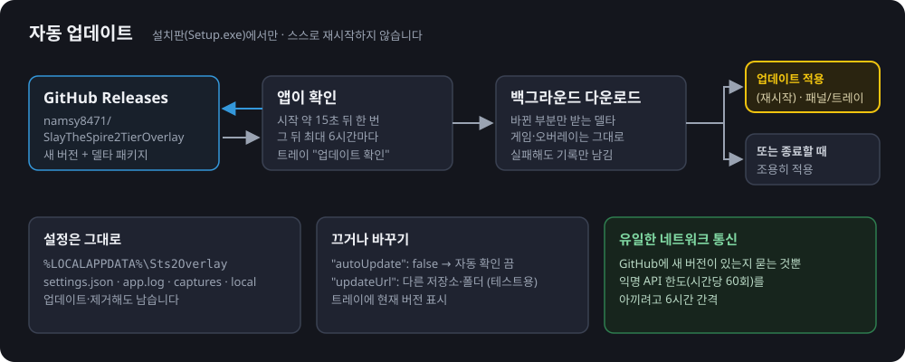

# 배포와 자동 업데이트

플레이어는 GitHub Releases에서 설치 파일을 받고, 앱은 같은 곳에서 새 버전을 받아 스스로 업데이트합니다. 설치·업데이트는 [Velopack](https://velopack.io/)이 맡습니다.
플레이어용 설명은 [README](../README.md#설치), 개발 환경은 [DEVELOPMENT.md](DEVELOPMENT.md)에 있습니다.



## 한눈에 보기

| 항목 | 값 |
|---|---|
| 배포 위치 | https://github.com/namsy8471/SlayTheSpire2TierOverlay/releases (공개 저장소) |
| 패키지 ID (`--packId`) | `namsy8471.Sts2Overlay` |
| 설치 파일 | `namsy8471.Sts2Overlay-win-Setup.exe` (서명 없음 → SmartScreen "추가 정보 → 실행") |
| 설치 위치 | `%LocalAppData%\namsy8471.Sts2Overlay` (사용자별, 관리자 권한 불필요). 시작 메뉴·바탕 화면 바로 가기 |
| 앱 파일 | 설치 위치의 `current\` (업데이트마다 통째로 바뀜). 버전은 `current\sq.version` |
| 설정·기록 | `%LOCALAPPDATA%\Sts2Overlay` (`settings.json`, `app.log`, `captures\`, `local\`). 업데이트·제거 후에도 남음 |
| 버전 | `Directory.Build.props`의 `<Version>0.1.0</Version>`이 기본값, 릴리스 때 태그(`v0.2.0` → `0.2.0`)가 `-p:Version`으로 덮어씀 |
| 지원 OS | Windows 10 2004 이상, x64 (`win-x64`) |
| 필요한 런타임 | .NET 10 데스크톱 런타임 x64. 없으면 설치 파일과 업데이트가 자동으로 설치함 (아래 "설치 크기") |

## 릴리스 흐름

```
release.cmd 0.2.0
  └─ tools\release.ps1: 검사 → 릴리스 노트(초안 → 메모장에서 다듬기) → 확인 → 노트를 메시지로 한 주석 태그 v0.2.0 만들고 push
        └─ GitHub Actions .github/workflows/release.yml (태그 v* push로 시작)
              build 잡 (windows-latest)
              1. 버전 확인 (SemVer 2, 같은 Release가 이미 있으면 나머지 건너뜀)
              2. dotnet test (Core, GameState, Resources, Vision, App 테스트, Release 구성)
              3. dotnet publish src/Sts2Overlay.App -c Release -r win-x64 --self-contained false -o publish -p:Version=0.2.0
              4. publish 폴더를 워크플로 아티팩트로 올림
              pack 잡 (ubuntu-latest, Windows용으로 cross-pack)
              5. dotnet tool restore  (vpk는 .config/dotnet-tools.json의 로컬 도구)
              6. 릴리스 노트 → release-notes.md: 주석 태그의 메시지, 없으면(가벼운 태그, 수동 실행) GitHub 자동 생성 노트,
                 그것도 없으면 커밋 목록 링크. 빈 본문은 만들지 않음
              6-b. (선택) advisor.lock.json이 있으면 전투 추천 도우미 zip을 받아 SHA-256 확인 → publish/advisor
                 (tools/advisor-package.ps1 -LockOnly, 아래 "Combat advisor helper". 파일이 없으면 한 줄 안내만)
              7. dotnet vpk [win] download github --channel win  (이전 릴리스를 받아 둠 → 델타 패키지용, 첫 릴리스면 건너뜀)
              8. dotnet vpk [win] pack --packId namsy8471.Sts2Overlay --packVersion 0.2.0 --packDir publish --mainExe Sts2Overlay.exe --channel win --framework net10.0-x64-desktop
                 --releaseNotes release-notes.md ...  (델타를 못 만들면 --delta none으로 다시 묶음: 안전망)
              9. dotnet vpk [win] upload github --channel win --publish --tag v0.2.0  (Release 공개)
             10. gh release edit v0.2.0 --notes-file release-notes.md  (vpk upload에는 본문 옵션이 없음. 본문이 비면 실패)
```

- **릴리스 노트는 태그에 있습니다.** `release.ps1`이 노트를 주석 태그(`git tag -a -F … --cleanup=verbatim`)의 메시지로 넣고, 워크플로가 `git for-each-ref refs/tags/v0.2.0 --format='%(contents)'`로 꺼냅니다. 같은 글이 GitHub Release 본문과 Velopack 패키지(`NotesMarkdown`)에 들어가고, 앱은 다운로드 완료 알림에 노트의 첫 두 항목을 "바뀐 점: …"으로 보여 줍니다. `--cleanup=verbatim`이 없으면 git이 `#`로 시작하는 줄(마크다운 제목)을 주석으로 보고 지웁니다.
- **이미 나간 릴리스의 본문 고치기:** `gh release edit v0.2.0 --notes-file notes.md`. 태그·에셋은 그대로 둡니다(이미 받은 패키지의 노트는 바뀌지 않음).

- **왜 묶기(pack)만 Linux에서 하나:** 델타는 vpk에 딸린 zstd가 만듭니다. 영어 Windows 러너(ANSI 코드 페이지 cp1252)에서는 한글 제목에서 생긴 `STS2 티어 오버레이_ExecutionStub.exe` 경로가 `??`로 깨져 델타가 실패했습니다(v0.1.1). Linux는 파일 이름을 UTF-8 그대로 넘깁니다. 제목을 영문으로 바꾸면 기존 사용자의 바로가기 이름이 바뀌므로 제목은 그대로 둡니다.
- **`--channel win`을 꼭 넘기는 이유:** Linux에서 돌면 채널 기본값이 `linux`라 `[win]`만으로는 `download`가 `releases.win.json`을 보지 않습니다(이전 릴리스 0개 → 델타 없음).
- **시험 실행:** Actions → release → Run workflow에서 `dry_run`(기본 켜짐)을 두면 Release를 만들지 않고 `releases-<버전>` 아티팩트로만 올립니다. 예: 버전 `0.1.2-test`로 돌려 델타가 생기는지 확인. 태그 push에는 이 입력이 없어 항상 공개합니다.

- 버전 이름에 `-`가 있으면(`0.2.0-beta.1`) 사전 릴리스(`--pre`)로 올립니다.
- Actions 화면의 **Run workflow**(workflow_dispatch)로 버전을 입력해 올릴 수도 있습니다. `dry_run`을 끄면 그 커밋에 태그가 새로 붙고 공개됩니다.
- publish는 단일 파일이 아니라 폴더입니다. Velopack이 폴더를 패키지(`.nupkg`)로 묶고, 이전 버전과의 차이로 델타 패키지를 만듭니다.
- Release에는 설치 파일(`…-win-Setup.exe`), 전체 패키지(`…-full.nupkg`), 델타 패키지(`…-delta.nupkg`), 피드 파일(`releases.win.json` 등)이 올라갑니다. 앱은 피드를 보고 델타가 있으면 델타만 받습니다.

## 릴리스 만들기

1. 올릴 커밋을 `main`에 합치고 push합니다.
2. 레포 맨 위의 `release.cmd`를 더블클릭하고 버전을 입력합니다(또는 `release.cmd 0.2.0`). 버전 앞에 `v`는 붙이지 않습니다.
3. 스크립트가 검사합니다: 추적 중인 파일에 커밋 안 된 변경이 없는지, HEAD가 upstream과 같은지(`git fetch` 후), 태그 `v<버전>`이 로컬·원격에 없는지, 이전 최신 태그보다 큰 버전인지.
4. **릴리스 노트:** 이전 태그 이후 병합된 PR 제목으로 초안을 만들어 `artifacts\release-notes\v<버전>.md`에 쓰고 메모장으로 엽니다. 플레이어가 읽을 글로 다듬어(한 줄에 변경 하나, "새 기능 / 개선 / 버그 수정 / 설치·업데이트" 같은 섹션) 저장하고 메모장을 닫으면 계속합니다. `<!--`로 시작하는 안내문 줄은 빠지고, 제목 말고 내용이 한 줄도 없으면 멈춥니다. 다시 실행하면 같은 초안을 이어서 엽니다.
5. 화면에 노트를 보여 주고, 확인하면 노트를 메시지로 한 주석 태그를 만들어 push하고, Actions 진행 페이지 주소를 알려 줍니다. 몇 분 뒤 Release가 공개되고, 켜져 있는 오버레이들은 다음 확인 때(최대 6시간) 받아 갑니다.

| 옵션 | 동작 |
|---|---|
| `-DryRun` | 검사만 하고 실행할 명령을 보여 줍니다. 태그·push·업로드는 하지 않습니다 |
| `-Local` | Actions 대신 이 PC에서 테스트·publish·`vpk pack`·`vpk upload`까지 합니다. 태그는 `vpk upload --tag`가 GitHub에 만듭니다. 토큰은 `$env:GITHUB_TOKEN`, 없으면 `gh auth token`(화면에 찍지 않음). 이 태그로 Actions가 다시 돌아도 Release가 이미 있으면 건너뜁니다 |
| `-NotesFile <파일>` | 릴리스 노트를 이 파일에서 읽습니다(초안·메모장 없음) |
| `-Yes` | 확인 질문을 건너뜁니다. 메모장도 열지 않으므로 `-NotesFile`과 함께 쓰세요(아니면 다듬지 않은 PR 제목 초안이 그대로 나감) |
| `-NoPause` | 끝나고 키 입력을 기다리지 않습니다 (자동화용) |

## 앱의 업데이트 동작

코드: `src/Sts2Overlay.App/Services/UpdateService.cs`, `UpdatePolicy.cs` (규칙은 `tests/Sts2Overlay.App.Tests/UpdatePolicyTests.cs`, 확인 결과 메시지는 `UpdateServiceTests.cs`에서 테스트).

- **설치판에서만** 동작합니다(`UpdateManager.IsInstalled`). checkout, `dist\Sts2Overlay.exe`, 그냥 publish한 폴더는 업데이트하지 않고, 트레이 버전 옆에 "(개발용)"이 붙습니다.
- 시작하고 **15초 뒤** 한 번 확인하고, 그 뒤로는 30분마다 "확인할 때가 됐는지"만 보고 실제 확인은 **최대 6시간마다** 합니다. 트레이 "업데이트 확인"은 바로 확인하되 1분에 한 번까지입니다.
- 새 버전이 있으면 백그라운드에서 받고, 패널 아래 초록 줄("새 버전 vX 준비됨 — 종료하면 적용")과 트레이 "업데이트 적용 (재시작) vX"를 보여 줍니다.
- 트레이 "업데이트 확인"은 결과를 **항상 트레이 알림(풍선)과 패널 줄**로 알려 줍니다: 확인 중… → 최신 버전입니다 (vX) / vX 다운로드 중… → 다운로드 완료 — 재시작하면 적용 / 실패 이유(인터넷 연결, GitHub 한도, 주소 오류 등) / 개발용 실행이라 확인하지 않음. 확인하는 동안 메뉴 항목은 "업데이트 확인 중…"으로 바뀌고 눌리지 않습니다. 자동 확인으로 받은 새 버전도 다운로드가 끝나면 알림을 띄웁니다. (패널은 게임이 앞에 있을 때만 보이므로 알림이 필요합니다.) 패키지에 릴리스 노트가 있으면 다운로드 완료 알림 끝에 "바뀐 점: (노트의 첫 두 항목)"이 붙습니다(`ReleaseNotesSummary`, 120자까지).
- 적용: 트레이에서 누르면 설정을 저장하며 정상 종료한 뒤 Velopack이 파일을 바꾸고 다시 켭니다. 안 누르면 오버레이가 종료될 때 조용히 적용하고 다시 켜지 않습니다. **스스로 재시작하는 일은 없습니다.**
- 자동 확인의 오프라인, GitHub 한도 초과, 피드 오류는 `app.log`에만 남고 다음 확인 때 다시 시도합니다.
- `settings.json`:
  - `"autoUpdate": false` — 자동 확인을 끕니다(트레이 "업데이트 확인"은 그대로).
  - `"updateUrl"` — 업데이트를 받을 곳. 비우면 공식 저장소. 다른 `https://github.com/<owner>/<repo>`, vpk 출력이 있는 http(s) 폴더, 로컬·네트워크 폴더 절대 경로(테스트용)를 받습니다. 잘못된 값이면 기록을 남기고 공식 저장소를 씁니다.

### 왜 6시간인가

GitHub의 익명 API는 **IP당 시간당 60회**까지입니다. 같은 공유기 뒤의 PC들은 이 한도를 나눠 씁니다. 오버레이를 자주 껐다 켜거나 여러 대가 켜 두어도 한도를 넘지 않도록, 시작할 때 한 번과 그 뒤 6시간 간격으로만 묻습니다. 앱이 외부와 하는 통신은 이 확인과 내려받기뿐입니다.

## 설치 크기

앱은 **프레임워크 의존(framework-dependent)** 방식으로 배포합니다. .NET을 앱 폴더에 통째로 넣지 않고 PC에 설치된 .NET 10 데스크톱 런타임을 씁니다.

| | v0.1.11 (self-contained) | 지금 |
|---|---|---|
| 설치 파일 `…-win-Setup.exe` | 95.5 MB | 23.0 MB |
| 전체 패키지 `…-full.nupkg` | 88.2 MB | 15.8 MB |
| 설치된 폴더 `current\` | 214 MB (529개 파일) | 43.6 MB (66개 파일) |

(`v0.1.11`은 공개된 릴리스의 값, "지금"은 같은 코드에 이 설정만 바꿔 개발 PC에서 `vpk pack`한 값입니다.)

- **왜 이렇게 줄어드나.** 예전 214 MB 중 약 150 MB가 .NET 런타임과 WPF·WinForms 자체였습니다. 빈 WPF 창 하나짜리 앱도 self-contained로 만들면 132 MB입니다. 이 부분은 PC에 한 번 설치되면 다른 .NET 앱과 같이 쓰는 공용 구성 요소입니다.
- **런타임이 없는 PC.** `vpk pack --framework net10.0-x64-desktop`이 패키지에 "이 런타임이 필요함"을 적어 둡니다(`.nuspec`의 `runtimeDependencies`). 설치 파일은 런타임이 없으면 Microsoft에서 받아 설치한 뒤 앱을 설치합니다. 업데이트도 적용 전에 같은 검사를 하므로, self-contained였던 0.1.11 이하에서 올라오는 사용자도 런타임이 없으면 설치 안내를 받습니다. 사용자가 취소하면 업데이트가 적용되지 않고 이전 버전이 그대로 남습니다.
- **이 옵션을 빼면 안 됩니다.** `--self-contained false`인데 `--framework`가 없으면, 런타임이 없는 PC에서 설치는 되지만 실행이 안 됩니다. `release.yml`과 `tools/release.ps1` 두 곳에 같이 들어 있습니다.
- **언어 리소스.** UI가 한국어와 영어뿐이라 `SatelliteResourceLanguages=ko;en`으로 다른 언어의 리소스 폴더를 뺍니다.
- **압축한 단일 실행 파일은 쓰지 않습니다.** 78 MB로 줄지만 켤 때마다 압축을 풀어야 하고, 파일 전체가 매번 달라져 델타 업데이트가 커집니다.
- **포터블 zip**(`…-win-Portable.zip`)은 런타임을 설치해 주지 않습니다. 런타임이 없으면 Windows가 ".NET 데스크톱 런타임을 설치하라"는 창과 다운로드 링크를 보여 줍니다.

## Combat advisor helper

전투 중 "이번 턴 추천 순서"([COMBAT_ADVISOR.md](COMBAT_ADVISOR.md))는 오버레이와 따로 빌드되는 도우미 프로그램이 계산합니다.
도우미는 비공개 저장소에서 빌드하며, 지금은 소스를 공개하지 않습니다(소유자는 나중에 공개할 계획입니다).
이 레포에는 **컴파일된 파일만** 배포물에 넣고, 바이너리도 소스도 커밋하지 않습니다. 도우미가 없는 빌드도 정상이며, 그때는 기능이 조용히 꺼집니다.

**파일.** 전투 도우미 실행 파일과 탐색 라이브러리, 테이블은 오버레이 exe 옆 `advisor\`에 둡니다. 비교 정책을 지원하는 도우미는 같은 폴더에서 R01 가중치도 읽습니다. 설치판의 경로는 `current\advisor\`입니다.

| 파일 | 크기(대략) | |
|---|---|---|
| `Sts2CombatAdvisor.exe` | 13.0 MB | self-contained 단일 파일. 오버레이가 찾는 파일(`AdvisorCommand.DefaultRelativePath`) |
| `sts2_search.dll` | 5.8 MB | 네이티브 탐색 라이브러리 |
| `search-tables.bin` | 10 KB | 탐색 테이블 |
| `combat-value-R01.json` | 0.4 MB | 아이언클래드 승천 0·10 비교용 전체 런에 쓴 전투 가중치. 앱 게시 단계에서 `data/advisor/`의 파일을 복사합니다. |
| `combat-value-a0-boss3.json` | 0.4 MB | 아이언클래드 승천 0의 3막 보스에 채택한 mix75 가중치. 같은 방식으로 복사합니다. |

`.pdb`, `runtimeconfig.json` 같은 다른 파일은 있어도 넣지 않습니다.

**가져오는 곳.** 모두 `tools/advisor-package.ps1`이 처리합니다. 위에서부터 처음 있는 것을 씁니다.

1. **`advisor-dist\`** (레포 맨 위, `.gitignore`): 세 파일을 손으로 넣어 두는 폴더입니다. `Sts2CombatAdvisor.exe`가 있으면 씁니다. exe만 있고 dll이나 테이블이 없으면 **빌드를 멈춥니다**.
   - `build-exe.cmd`: `dist\advisor\`에 넣습니다. 같은 파일은 건너뛰고, 실행 중인 도우미의 파일은 이름을 바꿔 치운 뒤(`*.old-…`, 다음 빌드 때 지움) 넣습니다. lock 파일은 보지 않습니다.
   - `release.cmd -Local`: `vpk pack` 전에 `publish\advisor\`에 넣습니다.
2. **`advisor.lock.json`** (레포 맨 위, 추적되는 파일): Actions는 비공개 저장소에 닿지 못하므로, 릴리스에 도우미를 넣으려면 이 파일을 커밋합니다. **기본은 없습니다.**

   ```json
   { "url": "https://github.com/<owner>/<repo>/releases/download/<tag>/advisor.zip", "sha256": "<zip의 SHA-256, 64자리 hex>", "version": "<표시용 버전>" }
   ```

   - `url`은 토큰 없이 받을 수 있는 `https://` 주소여야 합니다(시험용으로 `file://`도 받음). zip 안에는 세 파일이 맨 위에 있거나 하위 폴더 하나에 함께 있어야 합니다.
   - Actions의 pack 잡(`release.yml` "Combat advisor helper")과 `release.cmd -Local`(`advisor-dist\`가 없을 때)이 zip을 받아 **SHA-256이 다르면 릴리스를 실패**시키고, 맞으면 세 파일을 `publish/advisor`에 풉니다. `-Local`은 받은 zip을 `artifacts\advisor-cache\`에 두고 다시 씁니다.
   - 해시 만들기: `(Get-FileHash advisor.zip -Algorithm SHA256).Hash.ToLower()`.
3. **둘 다 없음**: "전투 추천 도우미 없음" 한 줄을 출력하고 도우미 없이 빌드합니다. 실패하지 않습니다.

스크립트 시험: `pwsh -File tools/advisor-package.ps1 -SelfTest`. 임시 폴더에 가짜 파일과 `file://` zip을 만들어 위 규칙(세 파일만 복사, exe만 있으면 실패, 해시 불일치 실패, lock 모양 검사, 캐시)을 확인합니다. 네트워크는 쓰지 않습니다. CI가 PowerShell 7(Linux)과 Windows PowerShell 5.1에서 돌립니다.

**크기.** 설치된 폴더가 약 **19 MB**(18.8 MB) 커집니다. 압축된 전체 패키지와 설치 파일은 약 9 MB 커집니다(개발 PC `vpk pack`: `…-full.nupkg` 9.9 → 19.2 MB).
Velopack 델타 업데이트는 바뀐 파일만 다시 보내므로, 도우미가 그대로인 업데이트에서는 도우미 몫이 거의 늘지 않습니다. 도우미가 바뀐 릴리스에서만 그 파일을 다시 받습니다.

**Velopack과 두 번째 exe.** `vpk pack --mainExe Sts2Overlay.exe`이므로 앱 항목은 오버레이 하나입니다. 도우미를 넣고 묶은 패키지를 열어 확인했습니다.
- `.nuspec`의 `mainExe`는 `Sts2Overlay.exe`입니다.
- 실행 스텁은 `STS2 티어 오버레이_ExecutionStub.exe` 하나뿐입니다(포터블 zip 맨 위의 `STS2 티어 오버레이.exe`).
- 도우미는 `current\advisor\`(nupkg에서는 `lib/app/advisor/`)에 그대로 들어갑니다.

바로 가기도 `mainExe`에만 만들어진다고 보고 있지만, 설치까지 해서 확인하지는 않았습니다.

## 데이터 위치

exe 위치를 보고 데이터를 어디서 읽고 쓸지 정합니다(`AppLayout.Resolve`, `src/Sts2Overlay.App/Infrastructure/AppPaths.cs`, 테스트 `AppLayoutTests.cs`). 처음 맞는 규칙을 씁니다.

| 실행 위치 | 읽기 전용 데이터 (`data/packs`, `data/catalog`) | 생성 데이터 (`LocalDataDir`: 카드 그림·이름·`manifest.json`) |
|---|---|---|
| **checkout**: exe 폴더나 그 위에 `data/packs`와 `.sln` 또는 `.git`이 있음 (`dotnet run`, `bin\...`, `dist\Sts2Overlay.exe`) | 레포 루트 | 레포의 `data/local/` (gitignore) |
| **설치판**: exe 옆에 `data/packs` | exe 폴더 (`current\`) | `%LOCALAPPDATA%\Sts2Overlay\local` |
| 위에 `data/packs`만 있고 표시 파일 없음 (복사·압축 해제한 레포) | 그 폴더 | 그 폴더의 `data/local/` |
| 어디에도 없음 | exe 폴더 (팩 없음으로 시작) | `%LOCALAPPDATA%\Sts2Overlay\local` |

설치판의 생성 데이터를 설치 폴더 밖에 두는 이유: Velopack은 업데이트 때 `current\`를 통째로 바꾸므로, 거기에 두면 업데이트마다 게임에서 다시 추출해야 합니다. 설정·로그·캡처는 어느 경우든 `%LOCALAPPDATA%\Sts2Overlay`입니다.

## 업데이트를 로컬에서 시험하기

GitHub에 올리지 않고 폴더 하나로 설치 → 업데이트 → 적용까지 확인하는 방법입니다. 레포 맨 위에서 PowerShell로:

```powershell
$feed = "$env:TEMP\sts2-update-feed"
dotnet tool restore

# 1) 0.0.1을 만들어 설치
dotnet publish src/Sts2Overlay.App -c Release -r win-x64 --self-contained false -o publish -p:Version=0.0.1
dotnet vpk pack --packId namsy8471.Sts2Overlay --packVersion 0.0.1 --packDir publish --mainExe Sts2Overlay.exe --framework net10.0-x64-desktop --outputDir $feed
& "$feed\namsy8471.Sts2Overlay-win-Setup.exe" --silent

# 2) 같은 폴더에 0.0.2를 만듦 (0.0.1과의 델타 패키지도 생김)
Remove-Item publish -Recurse -Force
dotnet publish src/Sts2Overlay.App -c Release -r win-x64 --self-contained false -o publish -p:Version=0.0.2
dotnet vpk pack --packId namsy8471.Sts2Overlay --packVersion 0.0.2 --packDir publish --mainExe Sts2Overlay.exe --framework net10.0-x64-desktop --outputDir $feed
```

3. 오버레이를 모두 끈 뒤 `%LOCALAPPDATA%\Sts2Overlay\settings.json`에 `"updateUrl": "C:\\Users\\<나>\\AppData\\Local\\Temp\\sts2-update-feed"`를 넣습니다(JSON이라 `\`를 두 번).
4. 시작 메뉴의 바로 가기로 설치판(0.0.1)을 켭니다. 트레이에 "버전 0.0.1"이 보입니다.
5. 15초쯤 기다리면 `app.log`에 `update: v0.0.2 available; downloading` → `update: v0.0.2 downloaded`가 찍히고, 패널에 "새 버전 v0.0.2 준비됨", 트레이에 "업데이트 적용 (재시작) v0.0.2"가 나옵니다.
6. 트레이 "업데이트 적용 (재시작)"을 누르거나 그냥 종료합니다. 확인:
   ```powershell
   Get-Content "$env:LOCALAPPDATA\namsy8471.Sts2Overlay\current\sq.version"   # 0.0.2
   ```
   다시 켜면 트레이에 "버전 0.0.2".
7. 정리: Windows **설정 → 앱 → 설치된 앱**에서 "STS2 티어 오버레이"를 제거하고, `settings.json`의 `updateUrl`을 지우고, `$feed`와 `publish` 폴더를 지웁니다.

주의: `settings.json`은 checkout 실행과 설치판이 같이 씁니다. 시험이 끝나면 `updateUrl`을 꼭 지우세요(남아 있으면 설치판이 공식 릴리스 대신 그 폴더를 봅니다).
